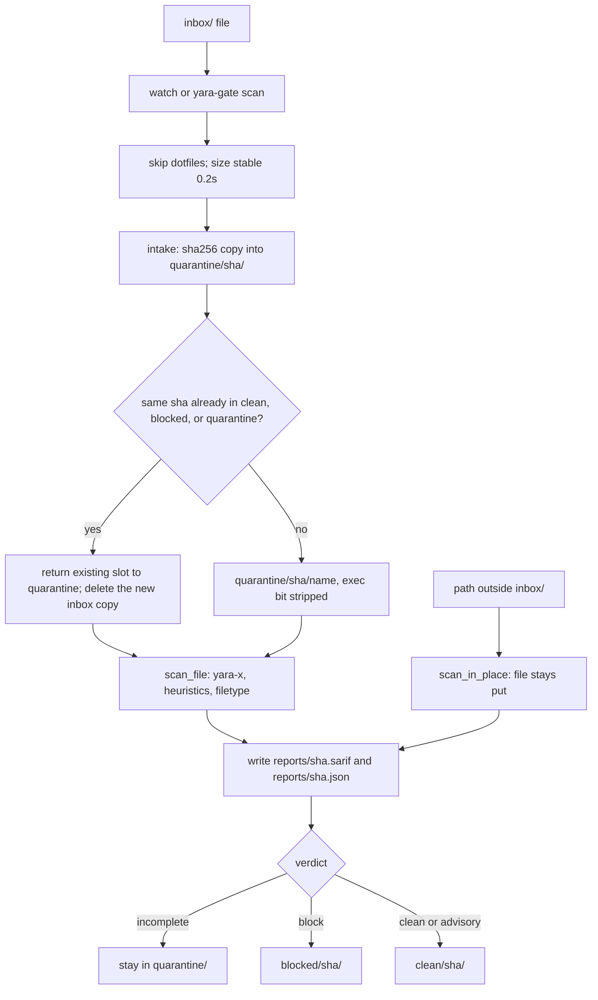

# yara-gate

yara-gate is a local intake gate for untrusted files before document processing, search indexing, or AI-agent ingestion. Its CLI and Python library combine YARA-X rules with bounded archive and document checks, then return a verdict that a downstream reader can act on.

The handoff from an incoming file to a reader is a verdict.

- Inbox files stay in `quarantine/` until the scan finishes. Blocked files go to `blocked/`. Unfinished scans stay in quarantine. A reader that uses the drop folder opens files from `clean/` and still reads the report.
- Default policy puts a finished clean or advisory scan in `clean/` and exits 0. `agent-ingest` holds every advisory as `block` and exits 1. The finding keeps its advisory severity. An incomplete scan still exits 2 and stays in quarantine.
- JSON and SARIF reports record the rule id, severity, policy, content view, and whether the scan finished. They do not copy the matched bytes. Exit codes separate an allowed file, a blocked file, and an unfinished scan.

The scan doesn't use the network. Curated rule packs are downloaded only when you run `rules install --allow-network` or `rules update --allow-network`. A rule is generated only after you confirm a file that is already in `blocked/`, and that candidate does not block anything until you promote it.

The private repository is [cgfixit/yara-gate](https://github.com/cgfixit/yara-gate).

## Where this helps CyClaw and CG-agent-harness

CyClaw answers from the operator's documents. Rebuilding the index reads `data/corpus/`. An external sync can drop files into that directory. CG-agent-harness local chat accepts attachments into the local model session. Its reviewed coding loop reads a repository the operator selected. Cloud chat on the harness does not send those attachments.

Scan the file before CyClaw indexes it, and before the harness puts an attachment or a repository file into the model prompt. The scan does not replace CyClaw's retrieval check, the consent check for Grok or Claude, or the harness checks on writes and publishing. A clean verdict is not permission to follow instructions found in the file.

Call `scan_file(path, policy="agent-ingest")`, or run `yara-gate scan path --json --policy agent-ingest`. Read the file only when the verdict is `clean`, the exit code is 0, and `incomplete_reason` is null. Use a gate home that is not shared with a default-policy watch. `scan_file` does not move the file and does not open a socket.

`agent-ingest` is the policy for both consumers. Several patterns below are advisory on purpose. A security note can quote an instruction and match. Hold that file for a person to review. Do not allow every file from a repository because the name looks safe.

On 2026-10-23, `git grep -i yara` on `origin/main` of [cgfixit/CyClaw](https://github.com/cgfixit/CyClaw) and [cgfixit/CG-agent-harness](https://github.com/cgfixit/CG-agent-harness) matched no file. Neither product calls this package yet. The caller contract is [Calling yara-gate from an ingestion pipeline](docs/integrations.md).

## See the policy decision

The live loopback demo calls the real scanner with the 40-rule local pack. In this
October 19 capture of the earlier 20-rule pack, an inert HTML-encoded instruction is detected in the
`html-unescaped` view. The `agent-ingest` policy holds the advisory as **block,
exit 1**, while retaining its advisory finding severity.


Under the default policy, that advisory is reported with exit 0. A downstream
consumer can instead require advisories to be held for review. Legitimate security
examples can match; the verdict records the selected policy, not proof of malice.
The demo does not move files. See the [screenshot gallery and capture provenance](screenshots/README.md),
including the earlier ClickFix policy comparison, or [run the live demo](#demo).
The [final combined acceptance record](docs/verification/final-acceptance.md)
includes fresh Computer Use screenshots and separate malformed-request checks.

## Install

From the project directory, on macOS or Linux, with [uv](https://docs.astral.sh/uv/) and Python 3.12:

```bash
cd ~/Projects/yara-gate
uv sync --frozen
uv run yara-gate --version
```

On Windows, only in-place scanning is supported and tested. A `windows-2025` CI job compiles the rules, runs the fire and near-miss pairs, and scans files outside the inbox with the library and the CLI (`docs/verification/check_scan_only.py`). Inbox intake, `watch`, and `selftest` depend on POSIX link checks (no-follow opens and link counts) and run only on Ubuntu 24.04 and macOS 15. The rules inspect Windows file types on every host.

`yara-gate 0.2.0` is the version this tree prints. The scanner imports the `yara-x` package (the lock resolves 1.22.0). It does not call the Homebrew `yara` binary.

`uv run yara-gate selftest` rebuilds the local fixtures and exits 0 only when every expected verdict matches. A fresh copy of this directory can run the same two commands. An installed copy copies the packaged local rules, not a checkout path that is not on disk. An unexpected selftest error prints `incomplete: <Type>` and exits 2. Selftest does not download malware. It writes the EICAR test string and small synthetic documents at run time.

## Drop folder

The default root is `~/YaraGate/`. Pass `--home` to use another directory. `ensure` creates the root and the five folders at mode `0700`, so other accounts on the Mac cannot list them. File bytes copied in stay mode `0644` with the executable bit removed.

| Directory | Role |
| --- | --- |
| `inbox/` | Drop files here |
| `quarantine/<sha256>/` | File is being scanned, or the scan did not finish |
| `clean/<sha256>/` | Clean, or advisory under the default policy. Readers must check the report |
| `blocked/<sha256>/` | A block rule or block heuristic matched |
| `reports/<sha256>.sarif` | SARIF 2.1.0 report, written for every scan |
| `reports/<sha256>.json` | The same verdict in compact JSON |

```bash
uv run yara-gate watch
```

Watch scans files already sitting in the inbox, then keeps scanning new ones. A second watch exits 2 while the first process is alive. The lock file is `~/YaraGate/.watch.pid`.

```bash
uv run yara-gate scan path/to/file
uv run yara-gate scan path/to/folder
```

A path inside the inbox is quarantined and then moved. Any other path stays where it is. The report is still written under the gate root. A folder scan uses the worst exit code in the folder.

On intake the tool hashes the file, copies it into `quarantine/<sha256>/`, strips the executable bit, and removes the inbox copy. Dropping the same bytes again reuses that slot and returns it to quarantine for a fresh scan under the selected policy.



## Exit codes

| Code | Verdict | Where the file goes |
| --- | --- | --- |
| 0 | `clean`, or `advisory` only | `clean/` |
| 1 | `block` | `blocked/` |
| 2 | `incomplete` | stays in `quarantine/` |

Advisory matches are listed in the report and set `"advisory": true`. They still exit 0. An unreadable file, a timeout, a size limit, a rules compile failure, or a missing `yara-x` import exits 2. An unhandled exception exits 2 and the message is the exception class name.

The default policy keeps the table above. For ingestion that must hold every advisory for review, select `agent-ingest`:

```bash
uv run yara-gate scan path/to/file --policy agent-ingest
uv run yara-gate watch --policy agent-ingest
```

Under `agent-ingest`, advisory findings produce a `block` verdict, exit 1, and `blocked/` for inbox files. Reports preserve each finding's original severity and include `policy` and `policy_reason`. Incomplete scans remain exit 2 in quarantine. The same bytes can be a security document that quotes an instruction. Pass `agent-ingest` when CyClaw or CG-agent-harness calls the gate. The scan default stays `default`. Use a separate gate home for each policy. Changing the policy does not rescan files already on disk until they are submitted again.

## Reports

Every scan writes both report files, including a clean scan. A finding stores the rule id, byte offset, and byte length. It does not store the matched bytes. Paths under your home directory are written as `~/...`. The path in the report is the quarantine path at scan time. The file is moved to `clean/` or `blocked/` after the report is written.

For automation, `yara-gate scan path/to/file --json` emits the same report schema
as one JSON object per file on stdout. Directory scans use JSON Lines and keep
the aggregate exit code. Diagnostics go to stderr. See the [integration contract
and ingestion example](docs/integrations.md); consumers must check both the
process exit and the returned records.

Findings also identify their YARA namespace, content `view`, and archive `member_path` as container ordinals such as `zip:0` (including directory entries in the numbering). Member names and decoded text are not copied into reports. Offsets refer to that member/view, not to the enclosing archive. SARIF keeps derived/member offsets in result properties instead of attaching them to the outer file's physical region. Scan records include the engine version, ruleset fingerprint, and skipped vendor-file count.

## Rule packs

`rules install` and `rules update` refuse to run unless you pass `--allow-network`. Those are the only commands that open a network connection. `rules install` downloads the URLs already in `rules.lock` and checks each sha256. `rules update` resolves current pins and writes a new lock only after the new vendor tree compiles. If either command fails, the previous vendor tree and lock stay as they were. The download allows only `https` URLs on `github.com`, `api.github.com`, `codeload.github.com`, and `release-assets.githubusercontent.com`, re-checks every redirect, and ignores `HTTP_PROXY`. If `GITHUB_TOKEN` is set, or else `GH_TOKEN`, it is sent only to `api.github.com` and removed when a redirect changes host. The token is not printed. A rate limit says `rate limited by api.github.com until <local time>; set GITHUB_TOKEN`. A missing URL says `not found: <url>`. Any other HTTP status says `HTTP <code> from <host>`. A network failure says `network unreachable`. Those failures still exit 2 and leave the vendor tree and lock unchanged. An installed copy includes `rules.lock`. `rules install` uses the root's lock when it exists, otherwise that packaged lock, and writes a copy into the rules root on success. Vendor rule bodies are still not packaged.

```bash
uv run yara-gate rules install --allow-network
uv run yara-gate rules update --allow-network
```

`rules/rules.lock` records the URL, pinned tag or commit, and sha256 of each download. The packs are YARA Forge core, Florian Roth's signature-base (`yara/` files), and Elastic protections-artifacts (`yara/` files). Rules that do not compile under yara-x are skipped and listed in `rules/vendor/SKIPPED.md`. If nothing compiles, scans exit 2.

The update run on 2026-10-04 pinned:

| Pack | Pin | Download sha256 |
| --- | --- | --- |
| yara-forge-core | `20261004` | `0b548dff76139b7a041d20923ccfddfa614db6b6ee8710c181ff037a753ffe69` |
| signature-base | `94a1c48d7ab499879287ff611dfe7f9c56376030` | `13895e9219e844beeba1f5d7d3e3261a81e4e8f69cf18cc823d3abcc16e601a3` |
| elastic | `83e227669df8a13a2a2fee52c14b742c0d5f17cc` | `ed1d0e2a11f5deab2de5c8978cf6667d1a53202b5bdb5c11b96c30cdb153ef8a` |

That compile produced 13535 rules and skipped 13. The compiled cache now lives in the user cache directory, not in `rules/.cache/`. A scan does not modify the rules tree. Vendor rule bodies are not committed. Elastic's rules are under the Elastic License 2.0. They stay in this local tree and are not packaged for redistribution.

The 40 local rules in `rules/local/` ship with the tool and need no download. Local-rule changes arrive with repository updates; `rules install` restores the packs recorded in `rules.lock`, and `rules update` refreshes vendor packs only. A fresh checkout has the local rules only until you install from the lock. `agent_eicar` matches the EICAR test marker. A compile failure in an active local rule makes scans incomplete even when other rules compile. Vendor compile skips remain permitted and are counted in reports.

A successful install or update also records `installed_vendor_files` in the
rules root's `rules.lock`. If a recorded file, pack directory, or the whole vendor
tree disappears, scans return incomplete/exit 2 with `installed vendor rules missing`;
inbox files stay quarantined. Reinstall the locked packs to restore coverage.
Fresh and legacy locks without this inventory still permit bundled-only offline
scans. Existing installations need one successful install or update with this
version to establish the inventory. Scans never create or repair it, and it is not
an integrity check against modified rule contents or deletion of the lock itself.
Older releases that reject unknown lock fields cannot read an inventoried lock.

An installed copy (wheel, `uv tool`, or pipx) reads those same rules from package data. The platform user-data directory, and a `YARA_GATE_RULES` directory that does not already contain every shipped rule name, loads the packaged rules first, then `<root>/local/` rules (`.yar` and `.yara`), then `<root>/vendor/`. A user file with the same name as a packaged file is not compiled. `rules install` and `rules update` print `local/<name>: shadowed by bundled` and count it in `skipped_rule_files`. Candidates are never loaded. If the packaged rules are missing or unreadable, the scan exits 2 with `bundled rules missing` and does not run on user or vendor rules alone. A checkout, or an explicit `--rules` directory whose `local/` contains every shipped name, is loaded once so those files are not compiled twice.

## What this catches, and what it does not

Installed curated packs add known malware signatures. Local heuristics check Office auto-exec macros (`olevba`), risky PDF tokens (`/JavaScript`, `/JS`, `/OpenAction`, `/AA`, `/Launch`, `/EmbeddedFile`, `/RichMedia`), and embedded executable headers. These checks also run on archive members. PDF feature names match complete decoded tokens (`/JS1` is not `/JS`); see the [name-boundary verification](docs/verification/pdf-name-boundaries.md). PDF token checks remain conservative feature restrictions; an ordinary navigation `/OpenAction` still blocks.

Bidi overrides, embeddings, and isolates block under both policies. A zero-width space, left-to-right or right-to-left mark, word joiner, internal BOM, or Unicode tag also blocks under both policies. A ZWJ inside an emoji sequence and a ZWNJ or ZWJ between Arabic, Persian, or Indic letters stay clean. Advisory rules cover authority and action spoofing, secret-transfer requests, selected base64 instruction phrases, external OOXML and RTF templates, and download-and-execute command combinations. Hidden-HTML indicators require a nearby instruction phrase. A text file's long-base64 detection survives a filename change to `.bin`.

Agent-ingestion heuristics also flag requests to persist approval/safety bypasses
in agent guidance or future sessions (`agent_persistent_instruction`) and textual
tool results asking a command tool to bypass controls (`agent_tool_output_override`).
Role/action detection includes Llama-style headers, `[start]`/`[message]` role
markers, and XML-style system/developer tags. These remain advisory: default
allows them with exit 0; `agent-ingest` holds them with exit 1. The phrase
“you are now” needs a nearby override/action, unrestricted-role, jailbreak-persona
(`DAN` case-sensitive, `developer mode`, `jailbroken`, “without restrictions”) term, including
inside hidden HTML, so ordinary connection-status text stays clean.
See [exact boundaries and measured collisions](docs/verification/agent-rule-coverage.md).

The delivery-pattern rules report these IDs:

| Rule ID | Required indicators | Finding severity |
| --- | --- | --- |
| [`web_clickfix_lure`](rules/local/web_clickfix_lure.yar) | Verification language, a clipboard-copy API (`writeText`, `write`, or `execCommand('copy')`), an instruction to open Run, a terminal, PowerShell, or the File Explorer address bar, and a paste instruction near each other | Advisory |
| [`web_html_smuggling`](rules/local/web_html_smuggling.yar) | Base64 decoding, Blob/URL APIs, and a nearby literal script, executable, disk-image, or archive download filename | Advisory |
| [`script_encoded_powershell`](rules/local/script_encoded_powershell.yar) | An encoded command plus a hidden-window flag or an execution policy of `Bypass` or `Unrestricted` in a bounded PowerShell command fragment | Advisory |
| [`script_mshta_remote`](rules/local/script_mshta_remote.yar) | A direct HTTP(S) target, or an inline `vbscript:` or `javascript:` URL, passed to `mshta` | Advisory |
| [`script_regsvr32_remote_scriptlet`](rules/local/script_regsvr32_remote_scriptlet.yara) | Regsvr32 with a remote `/i:` or `-i:` target and `scrobj.dll` in one bounded command | Advisory |
| [`script_rundll32_mshtml`](rules/local/script_rundll32_mshtml.yara) | Rundll32 JavaScript protocol invoking MSHTML `RunHTMLApplication` | Advisory |
| [`shortcut_powershell_encoded`](rules/local/shortcut_interpreter.yara) | Parsed PowerShell target plus encoded and hidden/bypass arguments | Advisory |
| [`shortcut_mshta_remote`](rules/local/shortcut_interpreter.yara) | Parsed MSHTA target with an HTTP(S) argument | Advisory |

The [October 13 attachment-signature research](docs/research/attachment-signatures.md)
records four attachment-signature rules, their benign boundaries, packaging checks, and
remaining shortcut and parser limitations. They add no network or target execution.

These lexical combinations can also occur in legitimate administration, export code, and security documentation. See [delivery-rule sources, exact boundaries, and verification](docs/research/modern-delivery-rules.md). They do not execute or decode the referenced payload. `agent-ingest` holds their advisories. A match identifies a pattern that needs review. It does not prove malicious intent.

### Windows shortcut-family checks

These rules look at the file's own format header, not its extension, so a renamed copy still matches. A Windows host acts on these files when Explorer shows, previews, or extracts them, often before anyone opens them. A macOS or Linux gate that syncs them to a Windows machine is still the place to hold them.

| Rule ID | Required indicators | Finding severity |
| --- | --- | --- |
| [`win_internet_shortcut_launch`](rules/local/windows_shortcut_remote.yar) | An `[InternetShortcut]` whose `URL=` is a `file:`, UNC, or `search-ms:` target or a local program path, or whose `WorkingDirectory=` is a UNC, WebDAV, or web location | Advisory |
| [`win_shortcut_remote_icon`](rules/local/windows_shortcut_remote.yar) | An `[InternetShortcut]`, `.scf` `[Shell]`, or `desktop.ini` `[.ShellClassInfo]` icon loaded from a UNC path or `file:` URL | Advisory |
| [`win_library_unc_location`](rules/local/windows_shortcut_remote.yar) | A file that opens with a `.library-ms` or `.searchConnector-ms` description (after an optional XML declaration) whose `<url>` is a UNC path (`\\host` or `//host`) or a `file:` URL with a host | Block |
| [`win_library_remote_location`](rules/local/windows_shortcut_remote.yar) | Any other description whose `<url>` is a UNC path, `file:` URL, or web address, including library XML quoted in a document | Advisory |
| [`web_search_ms_remote`](rules/local/windows_shortcut_remote.yar) | A `search-ms:` or `search:` link whose `crumb=location:` is a UNC path (plain or `%5C%5C`-encoded) or a web address | Advisory |

The shapes come from [CVE-2025-33053](https://blog.checkpoint.com/research/inside-stealth-falcons-espionage-campaign-using-a-microsoft-zero-day/) (a `.url` whose working directory is a WebDAV share), [CVE-2025-24054](https://research.checkpoint.com/2025/cve-2025-24054-ntlm-exploit-in-the-wild/) (a zipped `.library-ms` that leaks an NTLM hash), and [`search-ms` phishing](https://www.trellix.com/blogs/research/beyond-file-search-a-novel-method/). `win_library_unc_location` blocks because Windows contacts the SMB host as soon as Explorer lists the folder or the archive is extracted, which is the CVE-2025-24054 leak. A library that really lives on a company file server blocks too; release it through review. A CDATA wrapper or entity-encoded backslashes still block (the entities through the `html-unescaped` view). A comment before the root element, or more than 64 bytes of leading whitespace, drops such a file to the advisory rule; `agent-ingest` still holds it. An enterprise search connector to an `https://` SharePoint site, a local `file:///` location, or a folder icon on a file server also matches. Those stay advisory: the default policy allows them and `agent-ingest` holds them. A `.url` to an `https://` page, a local icon, and a `knownfolder:` library do not match.

### Later local checks

`rules/local/` in this tree has 40 YARA rules in 33 files. Recount them with `rg -N '^rule ' rules/local`. The delivery-pattern, Windows shortcut-family, and macOS and Linux launcher tables list their own rules. These checks are the ones none of them lists.

| ID | Severity | What it matches |
| --- | --- | --- |
| [`script_base64_decode_pipe`](rules/local/script_base64_decode_pipe.yar) | Advisory | `base64` decode piped into `sh`, `bash`, or `zsh` |
| [`script_osascript_shell`](rules/local/script_osascript_shell.yar) | Advisory | `osascript -e` running `do shell script` |
| [`script_clear_quarantine`](rules/local/script_clear_quarantine.yar) | Advisory | An `xattr` command (optionally after `sudo`) that deletes `com.apple.quarantine` (`-d`, `-rd`, `-r -d`) or clears every attribute (`-c`, `-cr`) |
| [`script_launchagent_shell`](rules/local/script_launchagent_shell.yar) | Advisory | LaunchAgent program arguments that run `/bin/sh`, `bash`, `zsh`, or `/usr/bin/python3`, `perl`, `ruby`, `osascript`, `curl`, or `env`, with `curl`, `wget`, `osascript`, `base64`, or `urlopen` in the plist |
| [`script_chmod_execute`](rules/local/script_chmod_execute.yar) | Advisory | `chmod +x`, `u+x`, or an octal mode, then a launch on the next line or after `&&` or `;` |
| [`doc_rtf_object`](rules/local/doc_rtf_object.yar) | Block | RTF object data or an object update |
| [`doc_svg_active`](rules/local/doc_svg_active.yar) | Block | An SVG with a script or an `onload` handler |
| [`agent_markdown_exfil`](rules/local/agent_markdown_exfil.yar) | Advisory | A Markdown image or link whose query contains a template |
| [`agent_fake_chat_marker`](rules/local/agent_fake_chat_marker.yar) | Advisory | A fake system or assistant chat marker with an instruction verb, or a closing tool-result tag with no opening tag |
| [`container_disk_image`](rules/local/container_disk_image.yar) | Advisory | ISO, VHD, or DMG magic at the offset that format uses |

`script_download_execute` matches `curl` or `wget` piped into `sh`, `bash`, `zsh`, `python`, or `perl`, with or without `sudo` in between; `bash <(curl …)` and `sh -c "$(curl …)"`; and a PowerShell download (`Invoke-WebRequest`, `Invoke-RestMethod`, `DownloadString`, `iwr`, `irm`) on the same line as `Invoke-Expression` or `iex`. The Homebrew install line is the known benign collision. It does not match a file that also contains "the following command", "common lure", or "for example" within 160 bytes before one of those download words. That exception covers the whole file. An SVG `foreignObject` without a script or an `onload` handler does not match `doc_svg_active`. A disk-image filename without the magic bytes does not match `container_disk_image`.

### macOS and Linux launcher checks

| Rule ID | Required indicators | Finding severity |
| --- | --- | --- |
| [`linux_desktop_exec_fetch`](rules/local/unix_launcher_lures.yar) | A `[Desktop Entry]` whose `Exec=` line runs `curl`, `wget`, `base64 -d`, `xxd -r`, or `openssl enc` | Advisory |
| [`script_fetch_chmod_run`](rules/local/unix_launcher_lures.yar) | One line that runs `curl` or `wget`, then `chmod` (`+x`, `u+x`, or an octal mode), then launches a path (`/`, `./`, `~/`, or a variable) | Advisory |
| [`web_applescript_url_lure`](rules/local/unix_launcher_lures.yar) | An `applescript://com.apple.scripteditor?action=new` link whose prefilled script contains `do shell script`, `curl`, or `osascript` | Advisory |

The `.desktop` shape is the [APT36 campaign](https://www.bleepingcomputer.com/news/security/apt36-hackers-abuse-linux-desktop-files-to-install-malware/) that shipped a launcher named like a PDF inside a zip. The download, `chmod`, run chain and `xattr -c` are the [AMOS stealer bootstrap](https://www.sophos.com/blog/why-amos-matters-the-macos-malware-stealing-data-at-scale). Script Editor links are the [ClickFix variant](https://www.bleepingcomputer.com/news/security/new-macos-stealer-campaign-uses-script-editor-in-clickfix-attack/) that avoids Terminal. A vendor install line such as `curl -o install.sh … && chmod +x install.sh && ./install.sh` also matches `script_fetch_chmod_run`. A chain that ends in `sudo mv` or an install step, a `chmod` on a later line, a `.desktop` file that only mentions `curl` in `Comment=`, and a Script Editor link that only shows a dialog do not match.

The scanner also reports these checks without a YARA rule. `heuristic_pickle_reduce` walks pickle opcodes. It blocks a `GLOBAL` or `STACK_GLOBAL` of `os`, `subprocess`, `builtins`, `posix`, or `nt`, or a callable named `eval` or `exec`, when a later `REDUCE` or `NEWOBJ` is present. Any name from those five modules blocks. The check is not limited to `system` or `popen`. The walker does not call `pickle.loads`. It skips `SHORT_BINBYTES` and `BINBYTES`. Any other opcode it does not know stops the walk and reports nothing. `heuristic_safetensors_header` blocks a `.safetensors` file whose header length or tensor offsets do not fit the file. `heuristic_gguf_header` blocks a `.gguf` file, or any bytes that start with `GGUF`, when the version is not 1, 2, or 3, the counts exceed 100,000, or a following record does not parse. `heuristic_ooxml_vba` and `heuristic_ooxml_dde` block. `heuristic_ooxml_oleobject` and `heuristic_ooxml_altchunk` are advisory. `heuristic_mcp_shell` and `heuristic_mcp_hidden_instruction` are advisory on a JSON object. `heuristic_double_extension`, `heuristic_filename_control`, `heuristic_document_executable`, and `heuristic_nested_executable` block. `heuristic_double_extension` matches a document, spreadsheet, image, media, or OneNote suffix, optional spaces, dots, or underscores, then a program suffix (`.exe`, `.scr`, `.com`, `.msi`, `.xll`, …) or a launcher suffix: Windows script hosts and shortcuts (`.lnk`, `.url`, `.js`, `.hta`, `.cmd`, `.ps1`, `.msc`, `.library-ms`, …), disk images that mount on a double-click (`.iso`, `.img`, `.vhd`, `.vhdx`), packages and manifests that install (`.msix`, `.appx`, `.application`, `.appref-ms`, `.msp`, `.chm`, `.diagcab`), registry and setup files (`.reg`, `.inf`), and macOS launchers (`.pkg`, `.dmg`, `.scpt`, `.terminal`, `.workflow`, `.command`, `.webloc`), so `invoice.pdf.lnk`, `photo.jpg.iso`, `statement.pdf.msix`, and `invoice.pdf      .exe` block. A `.txt` or `.html` decoy pairs only with a program suffix, so `page.html.js` stays clean; a single suffix such as `backup.iso` is not a disguise. `heuristic_filename_control` blocks a name that contains a bidi override, embedding, isolate or mark, a zero-width space, a word joiner, a BOM, or a Unicode tag (the `invoice_\u202Efdp.exe` trick). ZWNJ and ZWJ are allowed so Persian, Indic, and emoji names stay clean. Both checks read the submitted name and every component of an archive member's path, so an `Invoice.pdf.app/` bundle inside a zip blocks. Directories above a scanned file are not checked.

On the generated 267-file corpus, 36 of the 40 YARA rules hit 0 files, and no heuristic id hit. The rate is files hit divided by files scanned. The corpus includes 21 Windows shortcut-family files. The 17 ordinary ones (default libraries, Internet shortcuts, `.scf` files, `desktop.ini` in UTF-8 and UTF-16LE) hit nothing. The four that hit are tagged collisions: `win_library_unc_location` blocked a file-server library, and the advisory rules matched the rest. `win_library_remote_location` matched an https search connector, `win_shortcut_remote_icon` a file-server folder icon, and `win_internet_shortcut_launch` a `.url` to a local `file:` URL. See [Precision with Windows shortcut-family files](docs/verification/precision-windows-shortcuts.md); the near-miss pairs in `docs/verification/check_rule_pairs.py` remain the tighter benign boundary. The 32-rule write-up is [Precision after the local pack grew](docs/verification/precision-after-growth.md). Vendor rule bodies stay out of git. The license reasons are in [Vendor pack review](docs/verification/vendor-pack-review.md).

It does poorly against a new or targeted payload. YARA matches patterns somebody has already written down. Building a rule from the file you are judging only describes that file, so the tool never does that.

Other limits, measured in this tree:

- ZIP, tar, and gzip are inspected in memory with at most 3 container levels, 1,000 entries, 100 MiB per file/member, and a shared 500 MiB expanded/derived-content budget. Gzip counts as one level, including in `.tar.gz` or `.tgz`.
- Encrypted/unreadable archives, unsupported tar member types, and recognized 7z/RAR/bzip2/xz containers produce incomplete scans. Members are never extracted to filesystem paths.
- Raw bytes and UTF-8 derived views are scanned: BOM-marked or ASCII-heavy UTF-16 (`decoded-utf16`), HTML entity decoding (`html-unescaped`), JSON string escapes such as `\u0049` in a payload that starts with `{` or `[` (`json-unescaped`), removal of format controls for inspection (`format-controls-removed`), and the inflated text of a PDF's `FlateDecode` content and object streams (`pdf-flate`). The PDF view feeds both the YARA rules and the PDF name checks, so a `/JavaScript` action inside a compressed object stream blocks. Inflated streams that are not text (fonts, images) are dropped; a corrupt stream is skipped; each stream is capped at 100 MiB, the total at the shared 500 MiB budget, and more than 2,000 streams is incomplete. PNG predictors and other filters are not decoded. Originals remain unchanged. No general document-text extraction, OCR, arbitrary base64 decoding, or semantic prompt-injection guarantee is provided.
- Reads are capped by remaining byte budgets. A shared deadline is checked between extraction chunks and scan/view operations, and YARA receives the remaining time. Third-party archive metadata and Office parsing are not preempted by an OS process deadline.
- A `.pdf` that is really a zip is an advisory type mismatch and exits 0. A `.pdf` that is really a PE, ELF, or Mach-O exits 1. The same check reads `.jar`, `.apk`, `.msix`, `.appx`, `.xpi`, `.vsix`, `.nupkg`, `.whl`, `.epub`, and OpenDocument names as zips; `.xll`, `.cpl`, `.ocx`, `.sys`, `.drv`, and `.efi` as PE; and `.csv`, `.svg`, `.xml`, `.rtf`, `.ini`, `.url`, `.scf`, `.reg`, `.ps1`, `.vbs`, `.js`, `.sh`, `.bat`, and `.cmd` as text, so a PE saved under any of those text or zip names exits 1.
- A scan of a path outside the inbox does not move that file.

## Hunt

```bash
uv run yara-gate hunt --confirmed <sha256> --reason "why this file is bad" --scope ~/some/folder
uv run yara-gate rules promote <id>
```

`--confirmed` must name a file already in `blocked/`, and `--reason` is required. The reason is collapsed to one line, cut at 300 characters, then escaped. Control characters are removed. Non-ASCII text is stored as itself. The candidate keeps distinctive strings longer than 8 bytes that do not appear in `tests/fixtures/benign/`. It must hit the confirmed file and zero benign files. It is written to `<rules-root>/local/hunt_<first 12 hex of the sha>.yar` with `status = "candidate"`. In a checkout that root is `rules/`. In an installed copy it is the user-data directory. Creating `local/` there does not hide the packaged rules. Candidates are not loaded as block rules. `rules promote` rewrites the status to `promoted` and `verdict_on_match` to `block` only after the new text compiles.

## Library

```python
from yara_gate import scan_file

result = scan_file("attachment.bin", timeout_s=30)
result.verdict  # "clean", "advisory", "block", or "incomplete"
```

Pass `policy="agent-ingest"` for CyClaw corpus intake and for a harness attachment or repository read. The default remains `policy="default"`. See [Where this helps CyClaw and CG-agent-harness](#where-this-helps-cyclaw-and-cg-agent-harness).

`scan_file` does not move files and does not open a socket. `scan_bytes(data, name="message.txt")` scans a buffer you already hold, such as a chat or SMS message, with the same checks and no file at all; `yara-gate scan - --name message.txt` does the same for stdin. See [messages and other in-memory content](docs/integrations.md#messages-and-other-in-memory-content). Pass `rules_dir` to point at a different rules tree. The default is this project's `rules/` directory. A caller can use this function without the drop folder.

## Demo

`demo.html` is a limited standalone JavaScript illustration. It does not implement the full current rule pack, decoded views, archives, or policy. Use the live demo below to exercise the current scanner.

`yara-gate demo` is the full scan. It serves a page on `127.0.0.1` and prints the URL. Port `0` picks a free port. That page calls `scan_file` on a temporary file the server creates and deletes.

```bash
uv run yara-gate demo --rules rules
```

Pass `--rules` when you want a rules directory other than this project's `rules/`. The JSON answer has the verdict, the exit code, the sha256, and finding metadata. It does not include the file path or the pasted text.

The live page offers default and agent-ingest policies and labels the content view associated with each finding.

## Launch agent

`install-agent` writes a launchd plist and does not load it. You choose the destination. The plist runs `yara-gate watch` with the `--home` you pass. It stores no environment secrets. Logs are named under `~/Library/Logs/yara-gate/`.

```bash
uv run yara-gate install-agent --dest /tmp/com.cgfixit.yaragate.watch.plist --home ~/YaraGate
plutil -lint /tmp/com.cgfixit.yaragate.watch.plist
```

Create `~/Library/Logs/yara-gate` before you load the agent. Loading it is a separate `launchctl bootstrap` that this tree does not run for you.

## CI files

`.github/workflows/ci.yml` and `.github/workflows/codeql.yml` are in the tree. The Ubuntu and macOS job checks that `uv.lock` still matches `pyproject.toml`, then runs Ruff, mypy, the rule lint, the lock hash, the fire and near-miss pairs, the tracked-text control check (`check_text_controls.py`), the added-rule checks, the benign-corpus false-positive measurement (`measure_precision.py --fail-over`, which fails above 2% per rule), the in-place scans, the direct probe, selftest, and pytest. Actions are pinned to commit SHAs. The token permission is `contents: read`, except the CodeQL job which also has `security-events: write`. There is no `pull_request_target` trigger. Both workflows run on pull requests and on pushes to `main`; a newer push to the same pull request cancels the older run, and each job stops after 30 minutes. A third job, `scan-only (windows-2025)`, runs the rule checks and in-place scans on Windows. The Linux CI job lints the workflows with actionlint v1.7.12, built with `go install`, which checks the module against the Go checksum database. `.github/dependabot.yml` schedules weekly updates for `uv` and GitHub Actions.

For focused runtime verification, run `uv run python docs/research/probe_rule_coverage.py --verify`. It exercises real library scans and CLI intake in disposable homes, including strict-policy rescans and incomplete coverage, without executing target content. CI runs it on macOS and Linux before the existing regression suites. The [delivery-rule verification](docs/research/modern-delivery-rules.md#executed-verification) records the 16-rule pack's 70 library cases, 16 CLI operations, and three compilation/deadline checks. The initial [research](docs/research/universal-rule-research.md) and [intake verification](docs/verification/intake-coverage.md) preserve earlier evidence and remaining work.

The [October 19 dependency refresh](docs/verification/dependency-refresh.md)
records the earlier 20-rule pack, 120 library cases, 24 CLI operations and live
browser checks against the refreshed lock. Historical screenshots in the gallery
retain their original 16-rule provenance. The [October 22 agent-rule pass](docs/verification/agent-rule-coverage.md)
records the earlier 22-rule pack, 198 library cases, and 36 CLI operations. The current pack measurement is [Precision after the local pack grew](docs/verification/precision-after-growth.md).

`origin` is `cgfixit/yara-gate`. The workflow files do not by themselves turn on secret scanning, push protection, Dependabot alerts, code scanning, or branch protection. The checked-in CodeQL workflow runs Python queries with `upload: never` and `upload-database: false`; its success alone does not prove a security-dashboard upload. A separate GitHub-managed CodeQL workflow can also appear in PR checks. Repository settings and the exact workflow determine which scanning features run. `.github/dependabot.yml` schedules version updates; Dependabot alerts are a separate repository setting.

## Project files

Codex workflows are maintained under `.agents/skills/`. Invoke
`$yara-gate-invariant-guard` for the existing runtime probe, focused trust-boundary
checks and source review, then `$yara-gate-optimizer` for a requested improvement
pass. The optimizer is manual-only. Both are tailored to this repository; the
runtime and demo evidence skills supply their specialized verification steps.
`$cg-researcher-optimize` is the planning-first pass: a time-boxed read-only scan,
dated research on Windows, macOS, and Linux delivery techniques, reproduction of
each lead, and a plan of 4-7 independent PRs. Its
[PROMPT.md](.agents/skills/cg-researcher-optimize/PROMPT.md) is the same pass as a
standalone prompt for an agent that does not load skill files, such as Grok.

`pyproject.toml` names the package, the `yara-gate` command, and the ruff and mypy settings. `uv.lock` is the only dependency pin. Do not add a `requirements.txt` beside it. `.python-version` contains `3.12`, which is the interpreter `uv sync` should use. `src/yara_gate/py.typed` marks the importable package as typed. `LICENSE` is the MIT license. `.editorconfig` sets UTF-8, LF, and four-space Python indents so an editor matches ruff.

`.gitignore` drops the virtualenv, caches, `.env` files, `build/`, and coverage output. `rules/vendor/` stays untracked except `rules/vendor/SKIPPED.md` and `rules/vendor/.gitkeep`. `rules/.cache/` stays untracked. The vendor bodies include Elastic rules. This tree does not redistribute those rules.

## Layout

```text
demo.html              single-file browser page for the local patterns
pyproject.toml         package metadata, the yara-gate script, ruff, mypy, pytest
uv.lock                locked dependency set
.python-version        Python 3.12 pin for uv
src/yara_gate/         cli, quarantine, scanner, filetype, heuristics, rules, hunt, report, demo, launchd
src/yara_gate/py.typed empty marker that the package ships types
rules/local/           agent rules and promoted or candidate hunt rules
rules/vendor/          curated packs after an explicit update (not committed, except SKIPPED.md)
rules/rules.lock       pins for those packs
tests/                 fixtures are generated at run time, except the small benign text corpus
```
