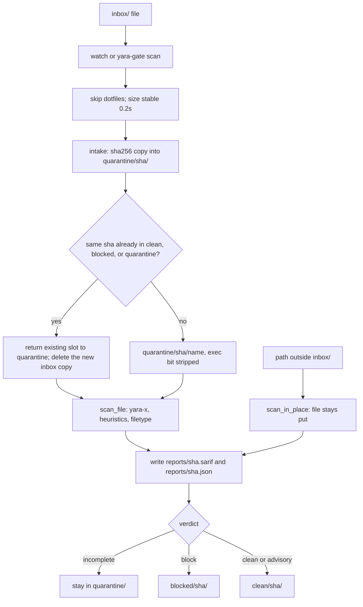

# yara-gate

yara-gate holds untrusted files until a local scan finishes. Drop a document in the inbox. The file moves to `clean/` only after the scan completes with a clean or advisory verdict. A block match moves it to `blocked/`. An unfinished scan leaves it in `quarantine/`. Readers such as an indexer or an agent should open files only from `clean/`.

The scan does not use the network. Curated rule packs are downloaded only when you run `rules update --allow-network`. A rule is generated only after you confirm a file that is already in `blocked/`, and that candidate does not block anything until you promote it.

The private repository is [cgfixit/yara-gate](https://github.com/cgfixit/yara-gate).

## Install

From the project directory, on macOS or Linux, with [uv](https://docs.astral.sh/uv/) and Python 3.12:

```bash
cd ~/Projects/yara-gate
uv sync
uv run yara-gate --version
```

`yara-gate 0.2.0` is the version this tree prints. The scanner imports the `yara-x` package (the lock resolves 1.21.0). It does not call the Homebrew `yara` binary.

`uv run yara-gate selftest` rebuilds the local fixtures and exits 0 only when every expected verdict matches. A fresh copy of this directory can run the same two commands. Selftest does not download malware. It writes the EICAR test string and small synthetic documents at run time.

## Drop folder

The default root is `~/YaraGate/`. Pass `--home` to use another directory. `ensure` creates the root and the five folders at mode `0700`, so other accounts on the Mac cannot list them. File bytes copied in stay mode `0644` with the executable bit removed.

| Directory | Role |
| --- | --- |
| `inbox/` | Drop files here |
| `quarantine/<sha256>/` | File is being scanned, or the scan did not finish |
| `clean/<sha256>/` | Clean, or advisory under the default policy. Readers must check the report |
| `blocked/<sha256>/` | A block rule or block heuristic matched |
| `reports/<sha256>.sarif` | SARIF 2.1.0 report, written for every scan |
| `reports/<sha256>.json` | The same verdict in compact JSON |

```bash
uv run yara-gate watch
```

Watch scans files already sitting in the inbox, then keeps scanning new ones. A second watch exits 2 while the first process is alive. The lock file is `~/YaraGate/.watch.pid`.

```bash
uv run yara-gate scan path/to/file
uv run yara-gate scan path/to/folder
```

A path inside the inbox is quarantined and then moved. Any other path stays where it is. The report is still written under the gate root. A folder scan uses the worst exit code in the folder.

On intake the tool hashes the file, copies it into `quarantine/<sha256>/`, strips the executable bit, and removes the inbox copy. Dropping the same bytes again reuses that slot and returns it to quarantine for a fresh scan under the selected policy.



## Exit codes

| Code | Verdict | Where the file goes |
| --- | --- | --- |
| 0 | `clean`, or `advisory` only | `clean/` |
| 1 | `block` | `blocked/` |
| 2 | `incomplete` | stays in `quarantine/` |

Advisory matches are listed in the report and set `"advisory": true`. They still exit 0. An unreadable file, a timeout, a size limit, a rules compile failure, or a missing `yara-x` import exits 2. An unhandled exception exits 2 and the message is the exception class name.

The default policy keeps the table above. For ingestion that must hold every advisory for review, select `agent-ingest`:

```bash
uv run yara-gate scan path/to/file --policy agent-ingest
uv run yara-gate watch --policy agent-ingest
```

Under `agent-ingest`, advisory findings produce a `block` verdict, exit 1, and `blocked/` for inbox files. Reports preserve each finding's original severity and include `policy` and `policy_reason`. Incomplete scans remain exit 2 in quarantine. This policy also holds benign advisory cases, such as directional isolates or security documentation quoting an instruction. Use a separate gate home for each consumer policy; changing policies does not rescan files already on disk until they are submitted again.

## Reports

Every scan writes both report files, including a clean scan. A finding stores the rule id, byte offset, and byte length. It does not store the matched bytes. Paths under your home directory are written as `~/...`. The path in the report is the quarantine path at scan time. The file is moved to `clean/` or `blocked/` after the report is written.

Findings also identify their YARA namespace, content `view`, and archive `member_path` as container ordinals such as `zip:0` (including directory entries in the numbering). Member names and decoded text are not copied into reports. Offsets refer to that member/view, not to the enclosing archive. SARIF keeps derived/member offsets in result properties instead of attaching them to the outer file's physical region. Scan records include the engine version, ruleset fingerprint, and skipped vendor-file count.

## Rule packs

`rules update` refuses to run unless you pass `--allow-network`. That is the only command that opens a network connection. The download allows only `https` URLs on `github.com` and `codeload.github.com`, and it ignores `HTTP_PROXY`.

```bash
uv run yara-gate rules update --allow-network
```

`rules/rules.lock` records the URL, pinned tag or commit, and sha256 of each download. The packs are YARA Forge core, Florian Roth's signature-base (`yara/` files), and Elastic protections-artifacts (`yara/` files). Rules that do not compile under yara-x are skipped and listed in `rules/vendor/SKIPPED.md`. If nothing compiles, scans exit 2.

The update run on 2026-10-04 pinned:

| Pack | Pin | Download sha256 |
| --- | --- | --- |
| yara-forge-core | `20261004` | `0b548dff76139b7a041d20923ccfddfa614db6b6ee8710c181ff037a753ffe69` |
| signature-base | `94a1c48d7ab499879287ff611dfe7f9c56376030` | `13895e9219e844beeba1f5d7d3e3261a81e4e8f69cf18cc823d3abcc16e601a3` |
| elastic | `83e227669df8a13a2a2fee52c14b742c0d5f17cc` | `ed1d0e2a11f5deab2de5c8978cf6667d1a53202b5bdb5c11b96c30cdb153ef8a` |

That compile produced 13535 rules and skipped 13. The on-disk rule-set hash is `47c2df1280a7fabf1d0110d7177b1ab215b8e2109d378f954886a44b336330c2` (`rules/.cache/<hash>.yarc`, not committed). Vendor rule bodies are not committed. Elastic's rules are under the Elastic License 2.0. They stay in this local tree and are not packaged for redistribution.

The 12 local rules in `rules/local/` ship with the tool and need no download. A fresh checkout has these rules only; `rules.lock` is a record of previous downloads, not an installed pack. `agent_eicar` matches the EICAR test marker. A compile failure in an active local rule makes scans incomplete even when other rules compile. Vendor compile skips remain permitted and are counted in reports.

## What this catches, and what it does not

Installed curated packs add known malware signatures. Local heuristics check Office auto-exec macros (`olevba`), risky PDF tokens (`/JavaScript`, `/JS`, `/OpenAction`, `/AA`, `/Launch`, `/EmbeddedFile`, `/RichMedia`), and embedded executable headers. These checks also run on archive members. PDF token checks remain conservative feature restrictions; an ordinary navigation `/OpenAction` still blocks.

Explicit left/right bidi overrides still block. Ordinary joiners used by emoji and language shaping no longer match the invisible-Unicode rule. Directional embeddings/isolates, zero-width spaces, internal BOMs, and Unicode tags are advisory. New advisory rules cover authority/action spoofing, secret-transfer requests, selected base64 instruction phrases, external OOXML/RTF templates, and download/execute command combinations. Hidden-HTML indicators require a nearby instruction phrase. A text file's long-base64 detection survives a filename change to `.bin`.

It does poorly against a new or targeted payload. YARA matches patterns somebody has already written down. Building a rule from the file you are judging only describes that file, so the tool never does that.

Other limits, measured in this tree:

- ZIP, tar, and gzip are inspected in memory with at most 3 container levels, 1,000 entries, 100 MiB per file/member, and a shared 500 MiB expanded/derived-content budget. Gzip counts as one level, including in `.tar.gz` or `.tgz`.
- Encrypted/unreadable archives, unsupported tar member types, and recognized 7z/RAR/bzip2/xz containers produce incomplete scans. Members are never extracted to filesystem paths.
- Raw bytes and UTF-8 derived views are scanned: BOM-marked or ASCII-heavy UTF-16, HTML entity decoding, and removal of format controls for inspection. Originals remain unchanged. No general document-text extraction, OCR, arbitrary base64 decoding, or semantic prompt-injection guarantee is provided.
- Reads are capped by remaining byte budgets. A shared deadline is checked between extraction chunks and scan/view operations, and YARA receives the remaining time. Third-party archive metadata and Office parsing are not preempted by an OS process deadline.
- A `.pdf` that is really a zip is an advisory type mismatch and exits 0. A `.pdf` that is really a PE, ELF, or Mach-O exits 1.
- A scan of a path outside the inbox does not move that file.

## Hunt

```bash
uv run yara-gate hunt --confirmed <sha256> --reason "why this file is bad" --scope ~/some/folder
uv run yara-gate rules promote <id>
```

`--confirmed` must name a file already in `blocked/`, and `--reason` is required. The candidate keeps distinctive strings longer than 8 bytes that do not appear in `tests/fixtures/benign/`. It must hit the confirmed file and zero benign files. It is written to `rules/local/hunt_<first 12 hex of the sha>.yar` with `status = "candidate"`. Candidates are not loaded as block rules. `rules promote` rewrites the status to `promoted` and `verdict_on_match` to `block` only after the new text compiles.

## Library

```python
from yara_gate import scan_file

result = scan_file("attachment.bin", timeout_s=30)
result.verdict  # "clean", "advisory", "block", or "incomplete"
```

Pass `policy="agent-ingest"` to hold all advisory findings as a block. The default remains `policy="default"`.

`scan_file` does not move files and does not open a socket. Pass `rules_dir` to point at a different rules tree. The default is this project's `rules/` directory. A later caller, including CyClaw before chunking, can use this function without taking the drop folder.

## Demo

`demo.html` is a limited standalone JavaScript illustration. It does not implement the full current rule pack, decoded views, archives, or policy. Use the live demo below to exercise the current scanner.

`yara-gate demo` is the full scan. It serves a page on `127.0.0.1` and prints the URL. Port `0` picks a free port. That page calls `scan_file` on a temporary file the server creates and deletes.

```bash
uv run yara-gate demo --rules rules
```

Pass `--rules` when you want a rules directory other than this project's `rules/`. The JSON answer has the verdict, the exit code, the sha256, and finding metadata. It does not include the file path or the pasted text.

The live page offers default and agent-ingest policies and labels the content view associated with each finding.

## Launch agent

`install-agent` writes a launchd plist and does not load it. You choose the destination. The plist runs `yara-gate watch` with the `--home` you pass. It stores no environment secrets. Logs are named under `~/Library/Logs/yara-gate/`.

```bash
uv run yara-gate install-agent --dest /tmp/com.cgfixit.yaragate.watch.plist --home ~/YaraGate
plutil -lint /tmp/com.cgfixit.yaragate.watch.plist
```

Create `~/Library/Logs/yara-gate` before you load the agent. Loading it is a separate `launchctl bootstrap` that this tree does not run for you.

## CI files

`.github/workflows/ci.yml` and `.github/workflows/codeql.yml` are in the tree. Actions are pinned to commit SHAs. The token permission is `contents: read`, except the CodeQL job which also has `security-events: write`. There is no `pull_request_target` trigger. `.github/dependabot.yml` schedules weekly updates for `uv` and GitHub Actions.

For focused runtime verification, run `uv run python docs/research/probe_rule_coverage.py --verify`. It exercises real library scans and CLI intake in disposable homes, including strict-policy rescans and incomplete coverage, without executing target content. CI runs it on macOS and Linux before the existing regression suites. The initial [research](docs/research/universal-rule-research.md) and [verification record](docs/verification/intake-coverage.md) describe the scope and remaining work.

`origin` is `cgfixit/yara-gate`. The workflow files do not by themselves turn on secret scanning, push protection, Dependabot alerts, code scanning, or branch protection. Secret scanning on a user-owned private repository requires GitHub Secret Protection. The CodeQL job still runs the Python queries and does not upload results, because code scanning is not enabled on this user-owned private repository. `.github/dependabot.yml` schedules version updates. Dependabot alerts are a separate repository setting.

## Project files

`pyproject.toml` names the package, the `yara-gate` command, and the ruff and mypy settings. `uv.lock` is the only dependency pin. Do not add a `requirements.txt` beside it. `.python-version` contains `3.12`, which is the interpreter `uv sync` should use. `src/yara_gate/py.typed` marks the importable package as typed. `LICENSE` is the MIT license. `.editorconfig` sets UTF-8, LF, and four-space Python indents so an editor matches ruff.

`.gitignore` drops the virtualenv, caches, `.env` files, `build/`, and coverage output. `rules/vendor/` stays untracked except `rules/vendor/SKIPPED.md` and `rules/vendor/.gitkeep`. `rules/.cache/` stays untracked. The vendor bodies include Elastic rules. This tree does not redistribute those rules.

## Layout

```text
demo.html              single-file browser page for the local patterns
pyproject.toml         package metadata, the yara-gate script, ruff, mypy, pytest
uv.lock                locked dependency set
.python-version        Python 3.12 pin for uv
src/yara_gate/         cli, quarantine, scanner, filetype, heuristics, rules, hunt, report, demo, launchd
src/yara_gate/py.typed empty marker that the package ships types
rules/local/           agent rules and promoted or candidate hunt rules
rules/vendor/          curated packs after an explicit update (not committed, except SKIPPED.md)
rules/rules.lock       pins for those packs
tests/                 fixtures are generated at run time, except the small benign text corpus
```
