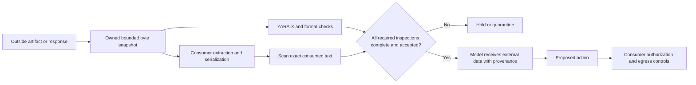

# External-content gates for agents and ordinary applications

Research date: October 23, 2026, America/New_York. Research baseline: yara-gate
`30d7126bc8ec60fed08094accbd3c0ffc8c9cb77`. The clean local `main` was fast-forwarded
19 commits from `b32ffe1` after fetching origin and confirming the repository's default
branch is `main`. Other worktrees were preserved. This document records research and inert
probes; the recommendations below are not installed integrations.

The subsequent [quotation-suppression fix and verification](../verification/quotation-suppression.md)
addresses the occurrence-specific gap below. This report and its recorded observations retain
the pre-fix baseline; the other proposed integrations and extraction work remain research.

## Recommendation

Use yara-gate as an inspection and hold decision before an application consumes outside
content. The strongest next work is to scan **both the original artifact and the exact text
the application will present**, bind that decision to those bytes, and retain independent
tool, file, memory, and network authorization in the application. Then measure a selected
malware feed and one optional local semantic classifier for additional coverage.

Adding thousands of malware signatures first will not close the demonstrated document-text
and serialization gaps. A clean result describes the reported compiled coverage and supported
views; vendor skips can coexist with clean. Required coverage needs separate verification.
It does not make outside text authoritative. OWASP recommends separation of
external content, least privilege, and validation at sensitive tools alongside detection.
[Prompt-injection guidance](https://cheatsheetseries.owasp.org/cheatsheets/LLM_Prompt_Injection_Prevention_Cheat_Sheet.html),
[MCP guidance](https://cheatsheetseries.owasp.org/cheatsheets/MCP_Security_Cheat_Sheet.html).

## Current baseline and direct observations

Current source already has role/action spoofing, secret-transfer, persistent-instruction,
tool-result, fake-chat-marker, selected encoded-instruction, hidden-HTML, Markdown-link,
Unicode, active-document, script-delivery, and model-file checks. It traverses ZIP/tar/gzip
and creates UTF-16, entity-decoded, and formatting-control views. These are existing features,
not proposed additions. See [scanner](../../src/yara_gate/scanner.py),
[content views](../../src/yara_gate/content.py), [heuristics](../../src/yara_gate/heuristics.py),
and [local rules](../../rules/local/).

Fresh local execution used macOS 27.0.1 ARM64, Python 3.12.12 and locked YARA-X 1.22.0 after
`uv sync --frozen --group dev`. A disposable copy of the 31 local source files compiled
**32 rules with zero skips**. Its ruleset fingerprint was
`e2949194c669ec919a49ee0c7dc3bd44c44412c9584745c03a2db5756844f9e3`.
There are no vendor rule bodies in this checkout's `rules/vendor/`; it contains `.gitkeep`
and the historical `SKIPPED.md`. The three lock entries are download pins, not active
coverage. The 13 skips in that historical file are not this fresh zero-skip result.

Seventeen inert fixture variants were each scanned through `scan_file` under both policies
(34 library calls). Five installed-CLI calls separately checked JSON records and exits.
Rules were copied, cache/home directories were disposable, and rule bytes were unchanged
afterward. No target command, referenced URL, model loader, or malicious sample was executed.

The exact [fixture generator and receipt checks](probe_external_content.py) and
[structured observations](external-content-boundaries-2026-10-23.json) are preserved beside
this note. The probe records its own digest, source revision, fixture hashes, ruleset/engine,
findings, CLI exits and native-parser checks. It reports misses as observations rather than
asserting that they are intended behavior. Run it from the repository root:

```sh
uv run --frozen python docs/research/probe_external_content.py > /tmp/external-content-boundaries.json
```

It uses only generated fixtures and cleans its temporary rules, homes and caches. Native
PDFKit/textutil checks run when their tools are available on macOS; other hosts explicitly
record those checks as unavailable. It does not invoke the existing broad probe or suites.

| Controlled input | Default result | `agent-ingest` result | What this establishes |
| --- | --- | --- | --- |
| Ordinary weather text | clean / 0 | clean / 0 | Benign control |
| Plain override phrase | advisory / 0 | block / 1 | Existing phrase detection and policy elevation |
| Paper-style quotation of the phrase | clean / 0 | clean / 0 | Existing documentary exception |
| That quotation plus a separate directive containing the same phrase | clean / 0 | clean / 0 | File-wide quotation suppression can hide another occurrence |
| Same instruction split by HTML tags | clean / 0 | clean / 0 | Entity decoding is not HTML text extraction |
| Same instruction with an HTML character entity | advisory / 0 | block / 1 | Existing `html-unescaped` view works for this case |
| Base64 of the selected ordinary-case phrase | advisory / 0 | block / 1 | Existing encoded-pattern coverage |
| Base64 of an alternating-case spelling | clean / 0 | clean / 0 | Selected encodings do not imply arbitrary decoded-text coverage |
| Spanish override/disclosure wording | clean / 0 | clean / 0 | This non-English example is outside lexical coverage |
| JSON `content` string with the initial letter written as a Unicode escape | clean / 0 | clean / 0 | General consumed JSON strings are not decoded as text views |
| Same JSON string in `description` | advisory / 0 | block / 1 | The MCP-description heuristic covers this particular field |
| PDF with the instruction in an uncompressed content stream | advisory / 0 | block / 1 | Raw bytes expose the phrase |
| PDF with the same content stream Flate-compressed | clean / 0 | clean / 0 | No general PDF text extraction before phrase inspection |
| DOCX with the phrase in one text run | advisory / 0 | block / 1 | ZIP member inspection finds the contiguous XML bytes |
| DOCX with the same paragraph split across two text runs | clean / 0 | clean / 0 | XML member inspection is not paragraph reconstruction |
| Gzip containing the ordinary-case phrase | advisory / 0 | block / 1 | Existing member traversal works for this case |
| Inert bytes carrying recognized unsupported 7z magic | incomplete / 2 | incomplete / 2 | Unsupported-container handling, not a full 7z parser test |

The two PDF fixtures were also read by the native PDFKit parser using Swift 6.4; both
extracted the identical controlled phrase. `/usr/bin/textutil -convert txt -stdout` extracted
that phrase from both DOCX fixtures. These independent parser checks establish recoverable
text equivalence for the fixtures, not browser rendering, the consumers' chosen extractors,
or native application acceptance. No extra PDF/Office dependency was installed.
The proposed second gate applies when a consumer actually exposes that representation.
Harness already has a [DOCX text extractor](https://github.com/cgfixit/CG-agent-harness/blob/8769d60637db2e23c45f368aa77fe33c602370a5/src/server/docx.rs#L250).
These probes do not establish that either app currently decodes every JSON field or accepts
PDFs through every intake route; the adapter must trace its own supported formats and views.

The CLI confirmed advisory/0 under default and block/1 under `agent-ingest` for the plain
phrase, clean/0 for the compressed PDF, and incomplete/2 for the unsupported-container
fixture. A missing path returned exit 2 with no JSON record. The initial scratch probe used
an unsupported `python -m yara_gate` entrypoint; those calls produced no scanner evidence.
The corrected run used this checkout's `.venv/bin/yara-gate` and checked record counts and
process/report exits.

The quotation miss follows directly from
[`agent_prompt_injection_phrases`](../../rules/local/agent_prompt_injection_phrases.yar):
`not $doc_phrase` excludes the entire phrase branch when a documentary match exists anywhere
in that content unit. A focused follow-up should evaluate occurrence-local exceptions and
retain benign quotation coverage. This is a demonstrated detection gap, not proof of an
unauthorized action in an app. None of these small fixtures establishes a production false
positive rate, attack success rate, or comprehensive recall.

## Where to integrate

Consumer source was inspected at CyClaw
`ae767ed9c6ecd64112993462370433c81e03707c` and CG-agent-harness
`8769d60637db2e23c45f368aa77fe33c602370a5`, both current default-branch snapshots during
research. No yara-gate call was found in the inspected execution paths. Existing sanitizers,
regex scanners, confinement, and approvals must stay in place.

| Consumer boundary | Smallest useful gate | Why an earlier scan alone is insufficient |
| --- | --- | --- |
| CyClaw corpus ingestion, `retrieval/indexer.py:load_corpus` | Inspect the bounded regular-file bytes before decode/chunk/embed; bind the result to the bytes already read | A later reopen can consume changed bytes; merely scanning a source pathname is insufficient |
| CyClaw retrieval and MCP search responses | Screen returned chunks and the externally controlled metadata in their final context representation; cover semantic, keyword and hybrid paths | Existing indexes predate a new ingestion gate, and an original-file `source_sha256` is not a receipt for current returned text |
| Harness chat attachments and notes, `verified_texts_locked` / `verified_texts` | Inspect verified bytes before classification/fencing and use; optionally hold at upload too | The existing scanner annotations do not themselves reject every suspicious attachment; stored content can outlive a policy change |
| Harness child repository reads and planner admission | Reuse bounded raw-byte inspection, then enforce admission when reads become planner context; inspect final visible text too | Upload gates miss child reads; blanket rejection in the shared reader would also break internal diff/drift operations |
| Harness web fetch/cache and model handoffs | Admit Page/extracted content under current rules, then each final fitted external-data payload; cover saved inject, research and tool chat | File intake never sees live web results; cache reuse and fitting can change which content reaches a model |
| Either app's persistence and side-effect tools | Validate memory writes, commands, destinations and secret access against trusted user/task authority at the actual effect | No text detector can authorize these effects or prevent every semantic miss |

Pinned sources: CyClaw
[indexer](https://github.com/cgfixit/CyClaw/blob/ae767ed9c6ecd64112993462370433c81e03707c/retrieval/indexer.py),
[graph/context assembly](https://github.com/cgfixit/CyClaw/blob/ae767ed9c6ecd64112993462370433c81e03707c/graph.py#L365),
[MCP server](https://github.com/cgfixit/CyClaw/blob/ae767ed9c6ecd64112993462370433c81e03707c/mcp_hybrid_server.py);
Harness
[attachments](https://github.com/cgfixit/CG-agent-harness/blob/8769d60637db2e23c45f368aa77fe33c602370a5/src/server/attachments.rs),
[notes](https://github.com/cgfixit/CG-agent-harness/blob/8769d60637db2e23c45f368aa77fe33c602370a5/src/server/notes_corpus.rs),
[workspace](https://github.com/cgfixit/CG-agent-harness/blob/8769d60637db2e23c45f368aa77fe33c602370a5/src/agentic/workspace.rs),
[web chat](https://github.com/cgfixit/CG-agent-harness/blob/8769d60637db2e23c45f368aa77fe33c602370a5/src/server/chat_web.rs),
[built-in regex scanner](https://github.com/cgfixit/CG-agent-harness/blob/8769d60637db2e23c45f368aa77fe33c602370a5/src/common/injection.rs).

For child reads, enforce holds at
[`edits::collect_checked`](https://github.com/cgfixit/CG-agent-harness/blob/8769d60637db2e23c45f368aa77fe33c602370a5/src/agentic/edits.rs#L63)
and selected [repository retrieval](https://github.com/cgfixit/CG-agent-harness/blob/8769d60637db2e23c45f368aa77fe33c602370a5/src/agentic/repo_retrieval.rs#L140)
when data becomes model-visible. Preserve
[original-byte/stale-write checks](https://github.com/cgfixit/CG-agent-harness/blob/8769d60637db2e23c45f368aa77fe33c602370a5/src/agentic/workspace.rs#L612)
and [human-review pending diffs](https://github.com/cgfixit/CG-agent-harness/blob/8769d60637db2e23c45f368aa77fe33c602370a5/src/agentic/commands.rs#L587).
These callers share `RepoWorkspace::read_file` but serve different purposes. Held source must
remain available for internal verification/review without entering the planner context.
The web proposal also covers
[saved context injection](https://github.com/cgfixit/CG-agent-harness/blob/8769d60637db2e23c45f368aa77fe33c602370a5/src/server/web_search.rs#L623),
[research planning](https://github.com/cgfixit/CG-agent-harness/blob/8769d60637db2e23c45f368aa77fe33c602370a5/src/server/web_research.rs#L513)
and [research synthesis](https://github.com/cgfixit/CG-agent-harness/blob/8769d60637db2e23c45f368aa77fe33c602370a5/src/server/web_research.rs#L586).

Harness MCP panel calls are a separate explicitly confirmed API in the inspected source;
do not assume arbitrary MCP responses already flow automatically into chat. Likewise,
`agent_tool_output_override` recognizes selected literal XML-like tags, not the MCP wire
protocol. The protocol adapter must select and decode text-bearing fields, then inspect the
actual assembled representation. Inspecting only a field named `description` is insufficient.

For general applications, use the same two boundaries: gate uploads/downloads before parsing
or indexing, and gate the final extracted text before an AI consumes it. Put source/config
checks before execution or installation and model checks before deserialization. Keep
ordinary document policy separate from AI-ingest policy: `agent-ingest` currently holds all
advisories, including legitimate security documentation. A proposed selective policy needs
explicit design and evaluation; arbitrary rule metadata does not implement it today.



### Byte identity and coverage contract

The shipped library accepts `scan_file(path)`; there is no public `scan_bytes` API. Read once
into a bounded adapter-owned buffer, scan a private copy, and require the report SHA-256 to
match the retained buffer. Derive and consume only that buffer, without reopening the
original pathname. A separate consumer must receive those validated bytes or verify its own
read before use. Ownership alone does not make a snapshot immutable. Apply the same binding
to extracted/serialized text. A byte-oriented API is a later small refactor if measured
overhead warrants it. Follow the
[existing CLI contract](../integrations.md): require the expected JSON record count, successful
process and report exits, `policy=agent-ingest`, clean verdict and no incomplete reason.
Malformed/missing output and required-detector failure hold the content. Require approved
engine/ruleset fingerprints and expected skip coverage established by a trusted preflight;
merely recording arbitrary returned identities is insufficient. Current JSON exposes a skip
count, so identifying individual skipped sources needs preflight evidence or a future manifest.
Missing required coverage must become adapter incomplete. Do not trust a `clean/` directory
name under default policy.

Preserve the logical basename/type safely within the private staging directory and bind it
into receipt identity. Replacing it with a random `.bin` name changes extension-sensitive
YARA globals, type mismatch, double-extension, MCP JSON and model-header checks even when the
bytes match. Never let an outside pathname choose the staging location.

Record the source digest, consumed-view digest, engine/ruleset identity, consumer policy and
extractor version. Classifier receipts additionally need model/tokenizer hashes, threshold
and window coverage. Invalidate cached decisions when those inputs change. Hashes establish
identity, not trustworthiness. Include metadata that enters context, not just the main body.
Scan externally sourced slices and metadata with source boundaries, keeping trusted system
guard text separate. Separately evaluate the assembled external-data section for composition;
running attack signatures over trusted instructions can self-trigger and obscure attribution.

Reuse the consumer's actual extractor instead of introducing a competing canonicalizer.
Keep originals and derived provenance; never attach derived/member offsets to physical outer
file regions. Unsupported required extraction, encryption, parser failure, truncation, or
resource limits are incomplete under a consumer profile that requires those views. The current
scanner can return clean without PDF text extraction; do not claim this proposed profile
already exists. Bound new extraction in an isolated process when a hard deadline is required:
the existing shared deadline does not preempt third-party parsers. PDF extraction can be
memory-intensive and does not supply OCR for image-only content.
[pypdf extraction limits](https://pypdf.readthedocs.io/en/stable/user/extract-text.html).

Preserve the existing archive budgets: 100 MiB per file/member, 500 MiB expanded, depth 3,
1,000 members. Do not disable them to admit large models. Image/audio instructions remain a
separate coverage requirement if the consuming model sees those modalities. Additional
Unicode/confusable views should be detection evidence, not destructive normalization;
Unicode explicitly cautions against treating confusable skeletons as normalization.
[UTS 39](https://www.unicode.org/reports/tr39/).

## Rules and engines worth evaluating

| Candidate | Useful role | Decision and limits |
| --- | --- | --- |
| Shipped local YARA + format checks | Cheap, explainable known indicators and dangerous attachment features | First close occurrence suppression and exact-view gaps. Expand contextual action/secret/persistence patterns only with matched benign controls; do not re-add features already shipped |
| YARA Forge core | General malware signatures for attachments and payloads | First aggregate to compare in an optional malware profile. Current upstream aggregates signature-base and ReversingLabs and deduplicates internally; independently installed packs can still overlap. Exact overlap in pinned release `20261004` was not measured. [Configuration](https://github.com/YARAHQ/yara-forge/blob/master/yara-forge-config.yml), [deduplication](https://github.com/YARAHQ/yara-forge/blob/master/main/rule_processors.py) |
| Direct signature-base | Potential marginal malware/hunting detections beyond the aggregate | Already pinned. Measure unique value and false blocks; upstream scores do not implement yara-gate policy. The locked external-variable inventory matches the 13 historical skipped filenames; do not supply dummy globals to conceal missing context. [Pinned inventory](https://github.com/Neo23x0/signature-base/blob/94a1c48d7ab499879287ff611dfe7f9c56376030/yara/external-variable-rules.txt) |
| ReversingLabs public rules | Focused malware subset with MIT terms | Reasonable alternative to a broad aggregate if it earns coverage for the intended formats. Already an input to current Forge, so separate installation must earn marginal value. Upstream false-positive claims are not measurements on these apps. [Source and scope](https://github.com/reversinglabs/reversinglabs-yara-rules), [license](https://github.com/reversinglabs/reversinglabs-yara-rules/blob/develop/LICENSE) |
| Elastic YARA | Endpoint-oriented Windows/macOS/Linux malware patterns | Already pinned; keep optional pending use-case and license review plus local evaluation. ELv2 permits distribution subject to conditions and limits certain hosted services; a blanket claim that redistribution is prohibited is too broad. [YARA scope](https://github.com/elastic/protections-artifacts/blob/main/yara/README.md), [pinned license](https://github.com/elastic/protections-artifacts/blob/83e227669df8a13a2a2fee52c14b742c0d5f17cc/LICENSE.txt) |
| ClamAV | Optional general attachment malware engine and document parsers | Distinct from importing more YARA. Map limits, skipped coverage, errors and unavailable databases to incomplete, record DB identity, and retain yara-gate's sole ownership of disposition. Official docs say oversized files can be skipped and assumed clean; an adapter cannot treat that as full inspection. [Scan behavior](https://docs.clamav.net/manual/Usage/Scanning.html) |
| Gitleaks | Optional secret-presence/DLP detection, especially at outbound effects | Use trusted explicit config, stdin, isolated cwd/environment, no inherited ignores/baselines and `--ignore-gitleaks-allow`. Outside text must not exempt itself. Preserve the byte-free report contract; raw reports can contain secrets. No online token validation during ordinary scans. [Source/options](https://github.com/gitleaks/gitleaks) |
| ModelScan / PickleScan / ModelAudit | Dedicated pre-deserialization model checks | Useful only for an app accepting those artifacts; keep unsupported formats incomplete and never load a target to validate it. Existing header/pickle checks are not comprehensive format validation. ModelAudit documents default telemetry and raw output that may contain secrets; explicit privacy controls and version/security review are prerequisites. [ModelScan](https://github.com/protectai/modelscan), [PickleScan](https://github.com/mmaitre314/picklescan), [ModelAudit security model](https://github.com/promptfoo/modelaudit/blob/main/docs/user/security-model.md), [telemetry configuration](https://github.com/promptfoo/modelaudit) |
| Semgrep | Optional structural source/config checks before code runs or installs | Use trusted local rules, never target-supplied configuration. Covered Semgrep Rules License rules are limited to internal business use and restrict redistribution/service availability; packaged apps should use first-party or otherwise suitably licensed rules. This is source analysis, not a general prompt-intent detector. [Rule model](https://semgrep.dev/docs/writing-rules/overview), [rule license](https://semgrep.dev/legal/rules-license/) |
| Sigma | Process/network/log monitoring after agent activity | Keep downstream of intake: file bytes do not supply the log-source semantics Sigma rules require. [Rule specification](https://sigmahq.io/docs/basics/rules.html) |

Two feed prerequisites are concrete. First, current findings discard author/source/license
metadata; the pinned signature-base DRL requires supplied author attribution in match-based
messages. Carry safe structured attribution without matched bytes, and inspect per-rule
exceptions. This is a literal license compatibility observation, not a full legal assessment.
[Pinned DRL](https://github.com/Neo23x0/signature-base/blob/94a1c48d7ab499879287ff611dfe7f9c56376030/LICENSE).
Forge's tool license is not a blanket license for every collected rule; its collector records
unknown-license entries. [Collector](https://github.com/YARAHQ/yara-forge/blob/master/main/rule_collector.py).

Second, every YARA hit without a valid `verdict_on_match` becomes block in the current scanner.
Hunting quality/score metadata is not a selective policy. Evaluate a pack's dispositions, not
just its compile count. Validate exact locked YARA-X behavior: upstream YARA compatibility
has documented regex/base64 differences. A skipped monolithic source can remove many rules
while adding only one to a file-based skip count.
[YARA-X differences](https://virustotal.github.io/yara-x/docs/writing_rules/differences-with-yara/).

Changing a vendor hit to advisory still holds it under `agent-ingest`. Usable selectivity
requires a selected inclusion set/rules root or a separately designed reviewed-release policy.
Only `default` and `agent-ingest` exist today. `update_packs` hardcodes all three feeds, so a
future selected profile also needs an update path that preserves its selection; ordinary
`rules update` does not supply that selection mechanism.

### Optional semantic detection

**Prompt Guard 2 86M is the first classifier candidate to evaluate**, after view coverage and
consumer gates. Its publisher describes binary detection of explicit known override attempts
and a 512-token context; the smaller 22M variant is a cost comparison if needed. Scan every
required window with overlap and report coverage. Overlap helps boundary cuts; it does not
solve arbitrary distant or cross-document composition. Benchmark the actual Mac/deployment
runtime: publisher GPU numbers establish no local latency or memory budget.
[86M model card](https://github.com/meta-llama/PurpleLlama/blob/main/Llama-Prompt-Guard-2/86M/MODEL_CARD.md),
[22M card](https://github.com/meta-llama/PurpleLlama/blob/main/Llama-Prompt-Guard-2/22M/MODEL_CARD.md).

Weights have their own Llama 4 access/use/distribution terms; do not infer their license from
the framework or base encoder. Pin weights, tokenizer, config and runtime; explicitly load
offline without remote custom code. A required missing/crashed/timed-out classifier or
unscanned tail is incomplete. Downloads belong to explicit installation, never a scan.
[Weight terms/access](https://huggingface.co/meta-llama/Llama-Prompt-Guard-2-86M).

ProtectAI's DeBERTa v2 model card now marks it archived, English-only and outside jailbreak
scope; use it as a historical comparison rather than the preferred new default.
[Model card](https://huggingface.co/protectai/deberta-v3-base-prompt-injection-v2).
LlamaFirewall's whole framework adds reasoning alignment checks, CodeShield and substantial
dependencies; a one-classifier adapter is a smaller first experiment. NeMo's retrieval and
execution rails are useful consumer concepts if an app already uses that stack, rather than
a reason to add a new policy framework to yara-gate.
[LlamaFirewall manifest](https://github.com/meta-llama/PurpleLlama/blob/main/LlamaFirewall/pyproject.toml),
[NeMo rail types](https://docs.nvidia.com/nemo/guardrails/about-nemo-guardrails-library/rail-types).

## What detection cannot authorize

Keep permission decisions at effects: allowed file roots, executable/tool names and typed
arguments, write approval, memory changes, and outbound destinations/data classes. Trusted
task authority must come from the user/application, never a statement inside scanned text.
Avoid automatic remote image/link fetching; Markdown exfiltration can cross an egress
boundary without a shell command. A secret detector finding and a request to steal a secret
are different signals and need different consumer policy.

False factual evidence is another class: a poisoned account number or policy can look like
ordinary data with no instruction phrase. Use authenticated structured sources and
independent confirmation for consequential destination/account changes. PoisonedRAG provides
research evidence for this distinction; a lexical or explicit-instruction classifier cannot
be assumed to solve it. [USENIX paper](https://www.usenix.org/conference/usenixsecurity25/presentation/zou-poisonedrag).

Google's agentic Chrome architecture illustrates an action critic separated from raw page
content and origin restrictions. CaMeL studies provenance/capability separation but explicitly
labels its released interpreter an unsupported, potentially insecure research artifact.
Borrow these boundary principles; do not import the research interpreter as a security fix.
Neither source establishes current protection in these two apps.
[Chrome architecture](https://blog.google/security/architecting-security-for-agentic/),
[CaMeL paper](https://arxiv.org/abs/2503.18813),
[implementation warning](https://github.com/google-research/camel-prompt-injection).

## Evaluation and delivery order

1. **Close the reproduced narrow gap and preserve quotation utility.** Add matched fixtures
   for a quoted example plus a separate directive, and several quoted/active occurrences.
   Verify actual rule IDs, policy results and benign boundaries. Do not delete the existing
   documentary exception just to increase catch rate.
2. **Implement one consumer path completely.** For CyClaw, gate ingestion and returned context,
   including pre-existing indexes and all exposed MCP search modes. For Harness, choose
   planner admission after bounded child reads or verified attachment/notes, then cover other
   surfaces separately. Record byte/view receipts and use actual sandboxed consumer calls.
3. **Establish a held-out evaluation.** Start with AgentDojo's MIT environment and matched
   first-party inert cases. Add relevant InjecAgent tool/data-stealing cases; its 1,054
   combinations are not 1,054 independent attack families. BIPIA adds task diversity, but its
   archived repo has dataset-specific license exceptions and external context downloads.
   Keep acquisition/attribution manifests; do not relabel all data MIT.
   [AgentDojo](https://github.com/ethz-spylab/agentdojo),
   [InjecAgent](https://github.com/uiuc-kang-lab/InjecAgent),
   [BIPIA license](https://github.com/microsoft/BIPIA/blob/main/LICENSE).
4. **Split before transformation.** Group source documents, attack families, paraphrases,
   encodings and all fragments in the same split. Keep separately authored final cases;
   public benchmarks may overlap model training. Include quoted attacks, administration
   docs, source code, chat logs, emoji/RTL/multilingual prose, long documents, malicious
   metadata, instruction-free answer poisoning and combined cross-source fragments.
5. **Measure the whole decision.** Freeze thresholds on development data. Report false holds
   per document and assembled retrieval request, per-family recall, incomplete counts and
   uncertainty. A 1% window false-positive rate does not imply a 1% document rate. A possible
   initial target is a one-sided 95% upper false-hold bound below 1% per consumer profile;
   zero holds requires about 300 independent benign documents, not 300 variants. This is a
   proposed operating tradeoff, not a measured or user-approved acceptance threshold.
6. **Measure marginal value.** Compare local-only, each existing feed and their union; then
   compare one classifier against YARA/extraction alone on identical held-out inputs at the
   same document-level false-hold operating point. Record exact feed/model identity,
   attribution, exclusions, duplicate detections, cold/warm latency, p50/p95 and peak memory.
   Existing [scan-overhead measurements](../verification/scan-overhead.md) are Linux/synthetic
   evidence, not the current Mac's real-feed or classifier performance.
7. **Test actual unauthorized effects.** Use synthetic secrets and instrumented mail/HTTP/
   write tools with real egress blocked. Count attempted versus executed effects and legitimate
   task completion. Test stale receipts, modified bytes, missing tools/models, malformed JSON,
   partial scans, limits, malicious configs/allow comments and persistence across sessions.
   Repeating attack text is not equivalent to stealing data or executing a command.
8. **Run bounded adaptive evaluation.** After freezing a candidate, test an informed attacker
   under a recorded attempt/query budget with isolated tools, held-out tasks and utility/effect
   reporting. Keep these results separate from static-template scores; evaluate new encodings,
   paraphrases and compositions rather than repeatedly tuning on the same final set.
   [NAACL 2025 adaptive evaluation](https://aclanthology.org/2025.findings-naacl.395/).
9. **Adopt only earned additions.** Keep the smallest feed/classifier/format-specific scanner
   that improves coverage within an explicit resource and false-hold budget. Preserve
   report-before-relocation, incomplete precedence, original finding severity, no matched
   bytes/secrets in reports and explicit operator-only update/download behavior.

The research phase changed no production source, rule, lock, consumer configuration or workflow.
The research probe passed Ruff lint and formatting; local document links resolve,
and all three new artifacts passed whitespace checks. The recorded probe digest matches the
preserved script. Three parallel source investigations and a follow-up source/caller review
were reconciled into this note. The script and observations are research evidence, not an
addition to hosted test wiring.
It did not install vendor packs or models, run benchmark datasets or broad local suites,
exercise either app end to end, establish Windows/native-product acceptance, or assess hosted
CI. The direct probes and native parser checks above are distinct from those missing evidence
classes. Arbitrary semantic, multimodal, adaptive and task-specific attacks remain possible.
