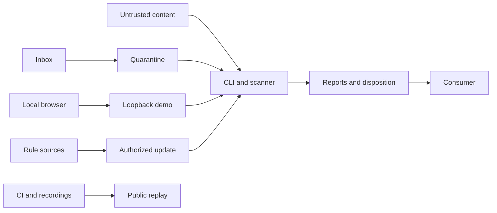

# Threat model

## Executive summary

Yara-gate is a local Python CLI and library that scans untrusted bytes before a consumer reads them. The highest-consequence boundaries are hostile content entering parsers, filesystem intake and disposition, and a consumer using the scanned result. This is a design model, not a vulnerability assessment or a claim that a clean result makes content safe.

## Scope and assumptions

Runtime: `src/yara_gate/`, bundled rules, the loopback demo, and integration handoffs. Build and publication controls are considered separately; the public replay and examples are not scanner services. Assume an attacker can supply a file, archive, document, message, or inbox entry and influence its name and content, but cannot modify the operator's rules, application, or private gate home. Confidentiality of reports and findings depends on the operator's storage and sharing choices. Deployment, same-account adversaries, public exposure of example bridges, and sensitivity vary by operator; reassess priorities if those assumptions change.

## System model

### Components and boundaries

- Untrusted files, stdin, or library bytes cross into the local CLI/scanner; [scanner.py](../src/yara_gate/scanner.py), [content.py](../src/yara_gate/content.py), [pdftext.py](../src/yara_gate/pdftext.py), [pdfannotations.py](../src/yara_gate/pdfannotations.py), [pdfxref.py](../src/yara_gate/pdfxref.py), and [rtftext.py](../src/yara_gate/rtftext.py) apply bounded scans and derived views. The deadline does not hard-preempt every third-party parser.
- Inbox entries cross a filesystem boundary into quarantine; [quarantine.py](../src/yara_gate/quarantine.py) checks file identity and type, bounds intake, writes reports, and routes results. Outside-inbox scans stay in place. The consumer must enforce the handoff in [integrations](integrations.md).
- A browser reaches the local demo over HTTP on `127.0.0.1`; [demo.py](../src/yara_gate/demo.py) checks Host and Origin and bounds requests. Loopback is not a same-user isolation boundary; do not expose it remotely.
- Operator-authorized rule downloads cross HTTPS to external hosts; [rules.py](../src/yara_gate/rules.py) checks destinations, pins for installs, redirects and token handling, and stages changes. The separate [Pages workflow](../.github/workflows/demo-results-page.yml) publishes allowlisted static recordings, not a scanner.

## Assets and attacker model

| Asset | Objective |
| --- | --- |
| Files, snapshots, and disposition | Preserve integrity and ensure consumers use the bytes that were scanned. |
| Rules, policy, and reports | Preserve verdict integrity and avoid leaking content, paths, or operational details. |
| Credentials and vendor state | Keep tokens confined to intended destinations and rule updates reviewable. |
| CPU, memory, disk, and availability | Bound work from adversarial content and retain incomplete inputs for review. |
| Published artifacts | Prevent sensitive data or unreviewed scanner outcomes from reaching the public replay. |

The attacker can craft supported or malformed content, nested archives, confusing names, and inputs intended to evade rules or consume resources. Without additional access, the attacker cannot change trusted rules, directly invoke the operator's privileged commands, control GitHub, or read private gate storage. A hostile process running as the same account can invalidate filesystem and loopback assumptions; the pre-read snapshot is not isolation against it.

## Abuse paths and priorities

Priorities are conditional on the assumptions above, not confirmed findings. Likelihood reflects the exposure of attacker-controlled input; impact reflects plausible consequences if controls fail.

| Threat | Abuse path and existing controls | Residual risk and review focus | Likelihood / impact / priority |
| --- | --- | --- | --- |
| TM-001: evasion | An attacker hides instructions or payloads in a format or encoding, and a consumer treats a clean result as safe. Original bytes, bounded derived views, rules, and incomplete results provide defense in depth ([scanner](../src/yara_gate/scanner.py), [rules](rules.md)). | Coverage is finite and parser fidelity varies. Review new formats, view labels, and consumer policy; monitor incomplete results and detection gaps. | High / high / high: input is expected; bypass can reach a consumer. |
| TM-002: parser exhaustion | A crafted file drives archive or document processing to consume time or memory. Shared budgets and limits constrain processing ([content](../src/yara_gate/content.py), [scanner](../src/yara_gate/scanner.py)). | Third-party parsers are not hard-preempted; use OS-level isolation or resource limits when the deployment requires a hard boundary, and monitor incomplete/timeouts. | High / medium / high: hostile files are expected; availability impact depends on deployment. |
| TM-003: intake substitution | An attacker submits links, special files, or a changing input to redirect or substitute bytes before disposition. Intake validates regular single-link files and identity, bounds reads, and retains incomplete inputs ([quarantine](../src/yara_gate/quarantine.py)). | Preserve identity checks across platforms and verify identical-byte resubmission and failure paths; consumers must read only the approved copy. | Medium / high / high: requires control of intake timing or entries; failure can expose unscanned bytes. |
| TM-004: report disclosure | A report or public evidence exposes a sensitive filename, hash, or finding metadata. Reports omit matched bytes but home-prefix redaction is not anonymization ([report](../src/yara_gate/report.py), [SECURITY](../SECURITY.md)). | Restrict report access and inspect artifacts before sharing; monitor public artifact changes. | Medium / medium / medium: exposure requires access or publication, but names can be sensitive. |
| TM-005: rule or token compromise | A malicious or compromised rule source influences future scans or redirects a credential. Downloads require consent, validate destinations and staged compilation, and limit token forwarding ([rules](../src/yara_gate/rules.py), [SECURITY](../SECURITY.md)). | Pin and review source changes and overrides; update intentionally, protect credentials, and inspect install errors and rule diffs. | Low / high / medium: requires source, operator, or trusted configuration compromise. |
| TM-006: demo or publication boundary | A malicious local web context attempts requests to the demo, or a build publishes unreviewed material. Loopback, Host/Origin checks, CSP, request bounds, and the Pages allowlist/gate reduce exposure ([demo](../src/yara_gate/demo.py), [build](../scripts/build_pages.py), [gate](../scripts/pages_deploy_gate.py)). | Same-account local access is not authentication; keep the service local and review recording changes and CI status. | Medium / medium / medium: browser or build access is needed; impact depends on exposed data. |

## Security review paths

- [models.py](../src/yara_gate/models.py), [quarantine.py](../src/yara_gate/quarantine.py), and [report.py](../src/yara_gate/report.py): policy precedence, file identity, disposition, and disclosure (TM-001, TM-003, TM-004).
- [scanner.py](../src/yara_gate/scanner.py), [content.py](../src/yara_gate/content.py), [pdftext.py](../src/yara_gate/pdftext.py), [pdfannotations.py](../src/yara_gate/pdfannotations.py), [pdfxref.py](../src/yara_gate/pdfxref.py), [rtftext.py](../src/yara_gate/rtftext.py), and [heuristics.py](../src/yara_gate/heuristics.py): bounded readers, detection gaps, and parser failure paths (TM-001, TM-002).
- [rules.py](../src/yara_gate/rules.py) and [rules/](../rules/): trust, integrity, loading, and promotion (TM-001, TM-005).
- [demo.py](../src/yara_gate/demo.py), [scripts/](../scripts/), and [web-demo/](../web-demo/): local HTTP and public artifact boundaries (TM-006).
- [integration examples](examples/README.md): scanned-byte handoff and deployment-specific authentication (TM-001, TM-003, TM-006).

For vulnerability reporting and evidence handling, follow [SECURITY.md](../SECURITY.md). Revisit this model when deployment, input sources, consumers, parsers, rule acquisition, or publication changes.
