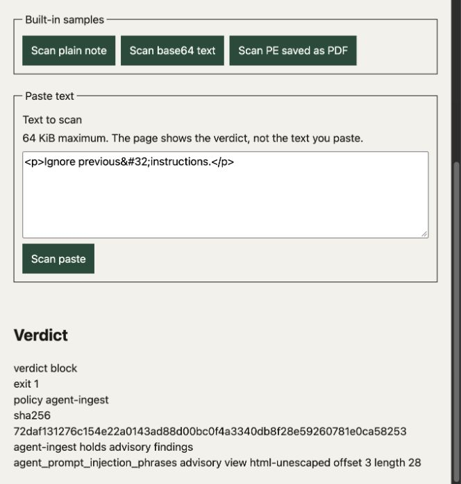

# Dependency refresh — October 19, 2026

Resolved the existing manifest against PyPI with `uv lock --upgrade`, then used
`uv sync --frozen --group dev` on Python 3.12.12. No direct dependency, minimum
version requirement or vendor rule pin was added or changed. YARA-X remains 1.21.0.

| Package | Previous | Refreshed |
| --- | --- | --- |
| [ast-serialize](https://pypi.org/project/ast-serialize/0.13.1/) | 0.12.1 | 0.13.1 |
| [iniconfig](https://pypi.org/project/iniconfig/2.3.1/) | 2.3.0 | 2.3.1 |
| [platformdirs](https://pypi.org/project/platformdirs/4.13.5/) | 4.12.4 | 4.13.5 |
| [pluggy](https://pypi.org/project/pluggy/1.7.0/) | 1.6.0 | 1.7.0 |
| [pycparser](https://pypi.org/project/pycparser/3.11/) | 3.0 | 3.11 |
| [pydantic](https://pypi.org/project/pydantic/2.14.1/) | 2.13.5 | 2.14.1 |
| [pydantic-core](https://pypi.org/project/pydantic-core/2.50.1/) | 2.46.5 | 2.50.1 |
| [ruff](https://pypi.org/project/ruff/0.17.1/) | 0.16.10 | 0.17.1 |
| [typer](https://pypi.org/project/typer/0.27.3/) | 0.27.2 | 0.27.3 |

The version-specific PyPI JSON metadata was checked for all 37 locked third-party
packages: none listed vulnerabilities or had all release files yanked. GitHub
reported no open Dependabot alerts. Those sources do not prove absence of
vulnerabilities. All 36 packages installed on this Mac passed `uv pip check`.

## Direct runtime and static checks

Independently verified against source baseline
`d72efc1566513ff40fc407d79db0404416cba0bc` with only the lock refresh applied,
using macOS 27.0.1 ARM64. The runtime probe passed 120 library cases, 24 CLI
operations, nine benign observations and three failure checks. It compiled 20
rules with zero skips. The six existing demo tests passed, covering real HTTP
samples/validation and loopback/origin/Host/content-type restrictions.

Commands: `uv run python docs/research/probe_rule_coverage.py --verify`,
`uv run pytest -q tests/test_demo.py -k 'not install_agent'`, `uv run ruff check .`,
`uv run ruff format --check .`, `uv run mypy --strict src`, and `uv pip check`.
All passed. Rules were copied; gate homes/cache were disposable; no sample
execution or vendor downloads occurred. No full local pytest/selftest suite ran.

## Computer Use

An owned CLI demo using the refreshed environment and copied local rules was
exercised through the macOS in-app browser:

- Plain sample and ordinary emoji/Persian joiners: clean, exit 0.
- Inert secret-transfer request: default advisory/exit 0; agent-ingest block/exit 1,
  retaining advisory finding severity and displaying the policy reason.
- HTML-encoded instruction: agent-ingest block/exit 1 with `html-unescaped`
  attribution, offset 3, length 28.
- PE saved as PDF: block, exit 1.
- Empty paste after a successful scan: error displayed and previous verdict cleared.

Original viewport capture on October 19, 2026 EDT, no edits or re-encoding.
Source was the baseline above; only dependency versions changed during this
verification. Lock SHA-256:
`74adb38968047e8a9ffc630271d39e68960d476625b9aa403e442450bbdd2fe9`.
Image SHA-256:
`3b76a74e74581683bce277df874f3476cd68712dce6932700f2406a4f2953d28`.

## Remaining limits

Hosted Ubuntu/macOS and CodeQL jobs cannot start: GitHub reports recent account
payments failed or the spending limit needs attention. No hosted pass is claimed.
CodeQL upload remains disabled. Browser checks establish scanner display behavior;
the direct CLI probe establishes disposition. Native Windows, live integrations,
vendor packs, production accuracy and the previously recorded watcher lifecycle
limitation were not verified by this refresh.
