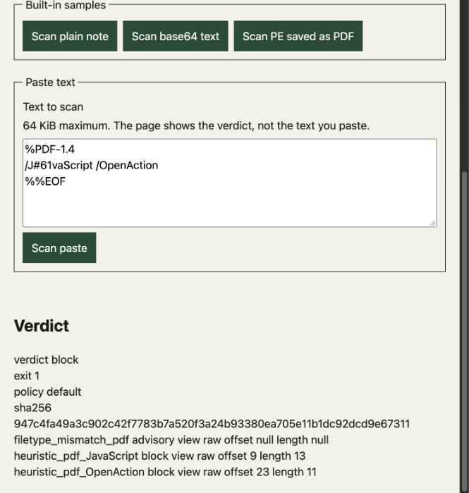

# PDF name fast path — 10 19 2026

Baseline: `d72efc1566513ff40fc407d79db0404416cba0bc`. Candidate changes only
`_decode_pdf_name`: names without `#` are returned unchanged instead of copied
byte by byte. Escaped names retain the existing decoder. Token order, first-match
selection, physical offsets and conservative PDF policy are unchanged.

## Runtime measurement

macOS 27.0.1 ARM64, Python 3.12.12, YARA-X 1.21.0, locked dependencies. Each
measurement used one warm-up and seven timed calls, with the same inert input:
`b"%PDF-1.4\n" + b"/OrdinaryName 0\n" * 20000 + b"%%EOF\n"` (300,015 bytes).
The full scanner used a `.pdf` file, copied shipped rules, a disposable cache and
`time.perf_counter()`. No vendor rules or target execution.

| Boundary | Baseline median | Candidate median |
| --- | --- | --- |
| `pdf_findings(payload)` | 113.78 ms | 56.55 ms |
| `scan_file(path, rules_dir=copied_rules)` | 129.17 ms | 72.01 ms |

Both scans returned clean with no findings. This synthetic ordinary-name-heavy
workload showed about 44% lower end-to-end time; it is not a production benchmark.
Documents whose names are all escaped still use the existing decoder.

The maintained `docs/research/probe_rule_coverage.py --verify` passed: 120 library
cases, 24 CLI operations, nine benign-corpus observations and three failure-path
checks; 20 compiled rules, zero skips. The four focused PDF regressions passed,
including escaped names, prefix boundaries and first physical spans. Ruff lint,
formatting and strict mypy passed. Broad pytest/selftest coverage belongs to CI.

## Computer Use

The in-app browser exercised an owned `127.0.0.1` demo with this candidate and
copied shipped rules. Source was the baseline plus the two-line fast path and
its regression; `heuristics.py` SHA-256 was
`7deb6b3b8da4fba1c5c2ffb3e68cf320091c9da36290f266ea4ac55a074dbbca`.

- `%PDF-1.4\n/OrdinaryName /JSuffix /OpenActionExtra\n%%EOF` produced only
  `filetype_mismatch_pdf`, advisory/exit 0. The paste is stored as `paste.txt`,
  so the type mismatch is expected; no PDF action heuristic matched.
- `%PDF-1.4\n/J#61vaScript /OpenAction\n%%EOF` blocked, exit 1. JavaScript
  retained physical offset 9/length 13; OpenAction retained offset 23/length 11.

Original viewport capture, October 19, 2026 EDT, macOS in-app browser, no edits
or re-encoding. Image SHA-256:
`4df9843434fe595d8003f588b898304032fe7445765a691d786ce65c68311e2a`.
This proves displayed scan results, not inbox relocation or a native application.
