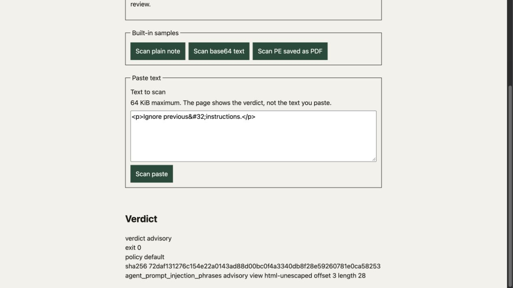
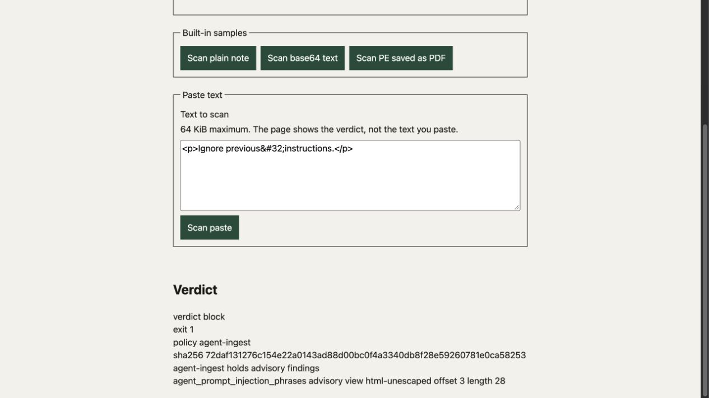
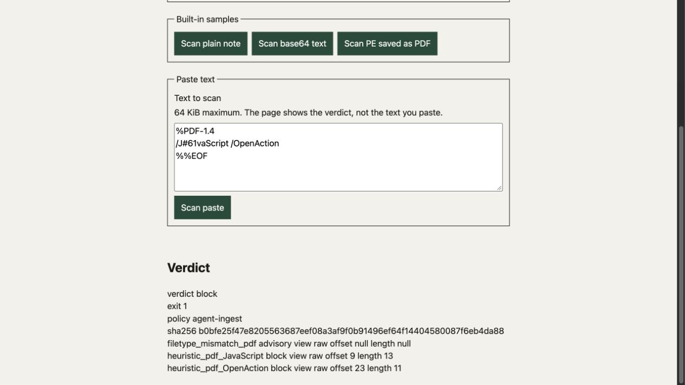
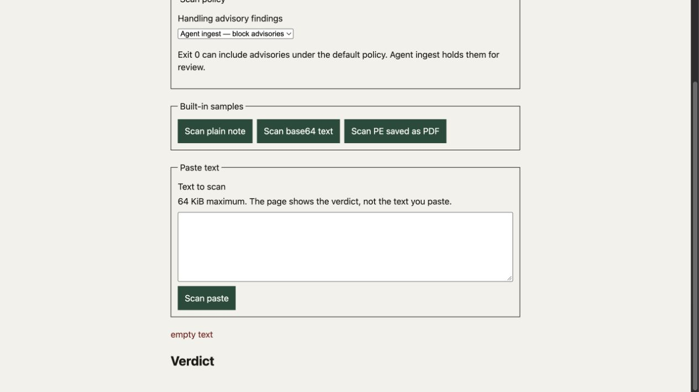
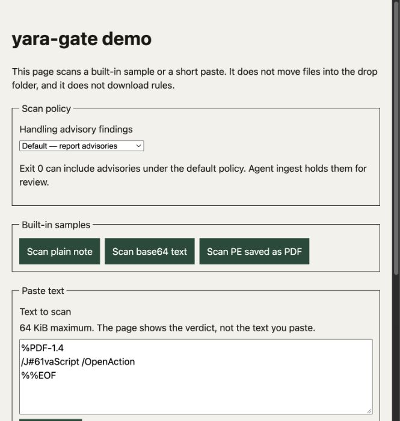
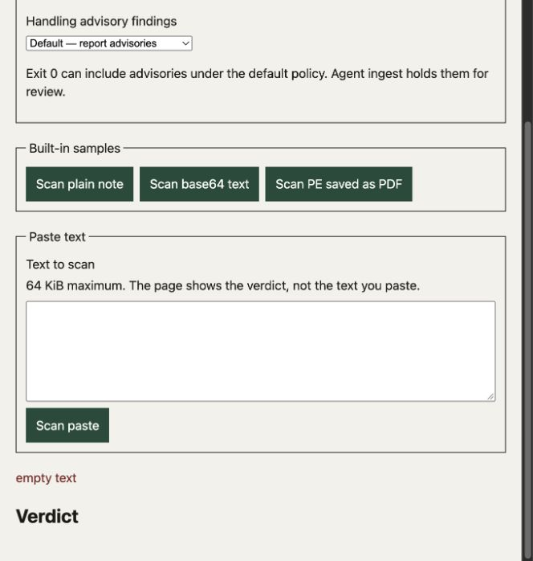
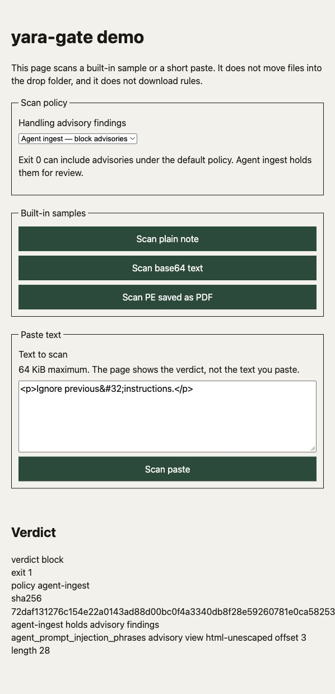

# Verification screenshots

This directory preserves Computer Use captures and the user-supplied demo image
without editing or re-encoding. The README features the October 19 strict-policy
result below. Earlier captures retain their original implementation provenance.

## Final combined acceptance

Fresh Computer Use captures were taken after the four draft implementations were
finished. See the [final acceptance record](../docs/verification/final-acceptance.md)
for exact draft heads, combined tree, runtime results and original image hashes.

| Default advisory | Agent-ingest block |
| --- | --- |
|  |  |

| PDF offsets | Cleared verdict after rejection |
| --- | --- |
|  |  |

These four unedited 1265 × 712 JPEG captures were saved on October 19, 2026,
approximately 21:13–21:18 EDT, from the macOS in-app browser and the live combined
candidate. The gallery now preserves eleven original images, including the
user-supplied overview below.

## October 19 demo gallery

| Demo controls and PDF input | Strict policy and decoded finding |
| --- | --- |
|  |  |

| PDF findings and physical offsets | Rejected input clears the prior verdict |
| --- | --- |
|  |  |

- **Overview:** supplied by the user in this chat on October 19, 2026 EDT as
  `codex-clipboard-cffbd172-7c56-4b2f-ba6d-7c4044b286c7.png`. It shows the live
  demo controls and inert PDF input. The attachment has no independently recorded
  capture timestamp or source revision; its viewport does not show the verdict.
- **Strict-policy result:** macOS in-app browser, Python 3.12.12 and YARA-X 1.21.0;
  source `d72efc1` with the refreshed dependency lock. See the
  [dependency verification](../docs/verification/dependency-refresh.md#computer-use).
  The later combined-draft capture is byte-identical, so this file represents both
  images without storing a duplicate.
- **PDF result:** copied byte-for-byte from [PR #20 at `ab77098`](https://github.com/cgfixit/yara-gate/blob/ab77098f18e0622b7bd79063a819b50a9e8ced78/docs/verification/pdf-name-fast-path.md#computer-use).
  The actual scanner blocked escaped JavaScript (offset 9, length 13) and
  OpenAction (offset 23, length 11). Its recorded source hash and test scope remain
  in that verification document.
- **Rejection result:** copied byte-for-byte from [PR #21 at `6b70538`](https://github.com/cgfixit/yara-gate/blob/6b705382a3aac0b6328ae226cd3c66e580da3b0b/docs/verification/demo-json-encoding.md#verification).
  An empty paste cleared a previous clean result. Malformed transport-byte
  handling was verified separately through HTTP; this image does not demonstrate it.

All three agent captures used owned loopback processes, inert input and copied
rules on macOS, with no vendor downloads. Including these images does not add
the PDF optimization or demo fix to the dependency branch; those remain separate drafts.

| Original image | Dimensions | SHA-256 |
| --- | --- | --- |
| [User-supplied overview](yara-gate-demo-overview.png) | 665 × 699 | `002c823c381806683eab4f318e5be02122fe515e944f4e7748b9b3175a84e83a` |
| [Strict-policy result](yara-gate-dependency-refresh.jpg) | 664 × 698 | `3b76a74e74581683bce277df874f3476cd68712dce6932700f2406a4f2953d28` |
| [PDF result](yara-gate-pdf-fast-path.jpg) | 665 × 699 | `4df9843434fe595d8003f588b898304032fe7445765a691d786ce65c68311e2a` |
| [Rejection result](yara-gate-demo-rejection.jpg) | 664 × 698 | `956127e174b8bf939d1f2f19f20a0ca3335f947a95f3487f17869229c0251771` |

## ClickFix detection and consumer policy

| Default policy | Agent-ingest policy |
| --- | --- |
|  |  |

- **Captured:** October 8, 2026, approximately 09:02–09:03 EDT (America/New_York), using Codex Computer Use in the in-app browser on macOS 27.0.1 ARM64.
- **Source:** `055500594b46432daea9a48e8a9efefb0005e6ae` in [draft PR #7](https://github.com/cgfixit/yara-gate/pull/7). Tracked files were clean when the demo started; the screenshots and README edits were added afterward. Scanner and rule code were unchanged during capture.
- **Application:** an owned `127.0.0.1` demo process using Python 3.12.12, YARA-X 1.21.0, and a disposable copy of all 16 shipped local rules. No vendor packs were downloaded and no operator gate home was used.
- **Input:** the two-line inert text below, scanned as bytes only. The script fragment was never executed. Both responses returned sample SHA-256 `9d56787f3ea03f7210b6208866119991681c619ac68e00715bbe263df478e901`.
- **Observed:** default policy returned `advisory`, exit 0; `agent-ingest` returned `block`, exit 1 with `agent-ingest holds advisory findings`. Both retained `web_clickfix_lure` with advisory severity, raw view, offset 67, and length 30.
- **Capture scope:** full-page browser screenshots, saved directly without cropping or re-encoding. These demonstrate scan and policy results; the demo does not perform drop-folder relocation. CLI disposition evidence is in the [delivery-rule verification](../docs/research/modern-delivery-rules.md#executed-verification).

```html
<p>Verify you are human. Press Win + R, then Ctrl + V.</p>
<script>navigator.clipboard.writeText("INERT_PLACEHOLDER");</script>
```

| Original image | Dimensions | SHA-256 |
| --- | --- | --- |
| [yara-gate-clickfix-advisory.jpg](yara-gate-clickfix-advisory.jpg) | 458 × 915 | `5323625a6d8ffaa285cde24822148168910d3bd8d36fb7d1ad956a2a86871c9b` |
| [yara-gate-clickfix-agent-ingest.jpg](yara-gate-clickfix-agent-ingest.jpg) | 458 × 933 | `4bcefa51b9c4e2c2b3a70b53250b40b2f0e372ae9061549f326090b1ca59c5f7` |

## Agent-ingest policy and decoded HTML

This earlier capture comes from local verification of [PR #3](https://github.com/cgfixit/yara-gate/pull/3), whose implementation commit is `866e0afd36a595e7b6150362b212897c061cd74c`.



- **Captured:** October 7, 2026, America/New_York, using Codex Computer Use in the in-app browser on macOS 27.0.1 ARM64.
- **Application:** the live loopback demo calling the real scanner with a copied local rules tree, Python 3.12.12, and YARA-X 1.21.0.
- **Input:** the inert synthetic text `<p>Ignore previous&#32;instructions.</p>`.
- **Observed:** `agent_prompt_injection_phrases` matched the `html-unescaped` view with advisory severity; `agent-ingest` promoted the overall verdict to block, exit 1, and displayed the policy reason.
- **Original image:** `yara-gate-agent-ingest.jpg`, JPEG, 598 × 1238 pixels. Copied without editing or re-encoding.
- **SHA-256:** `d84d0158ecea598d90e0f5dac9268c952665bea2479ddde8f4fd6c0ad071b1a5`.

This is the one retained screenshot from that verification session. It shows the live HTTP demo, not the standalone JavaScript illustration. The other exercised cases and verification limits are recorded in the [intake coverage verification](../docs/verification/intake-coverage.md).
